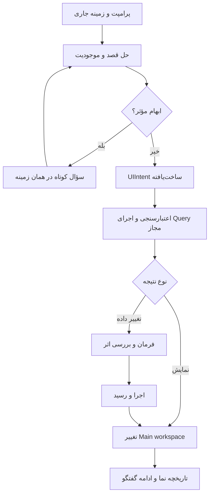
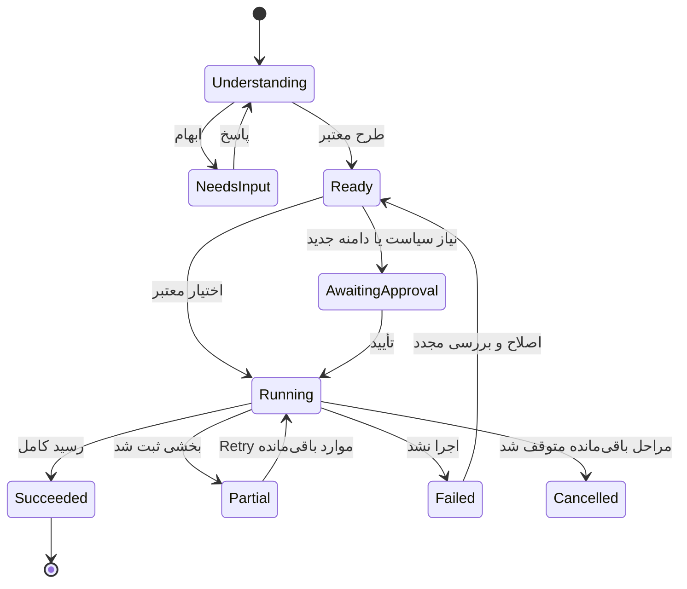
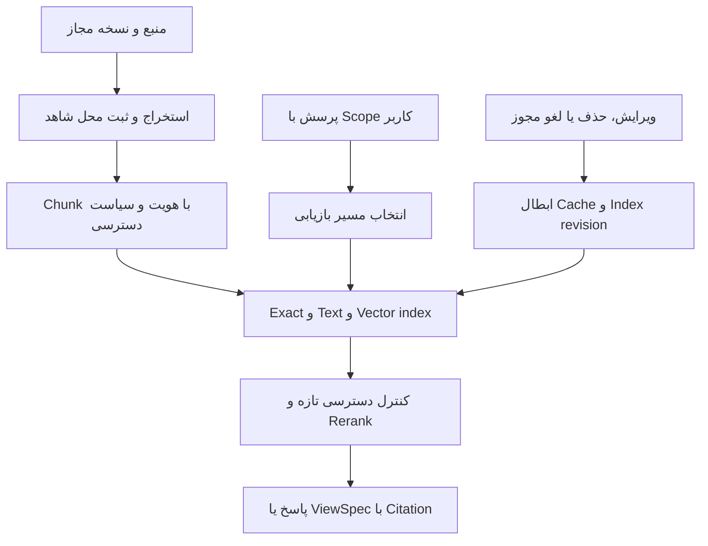
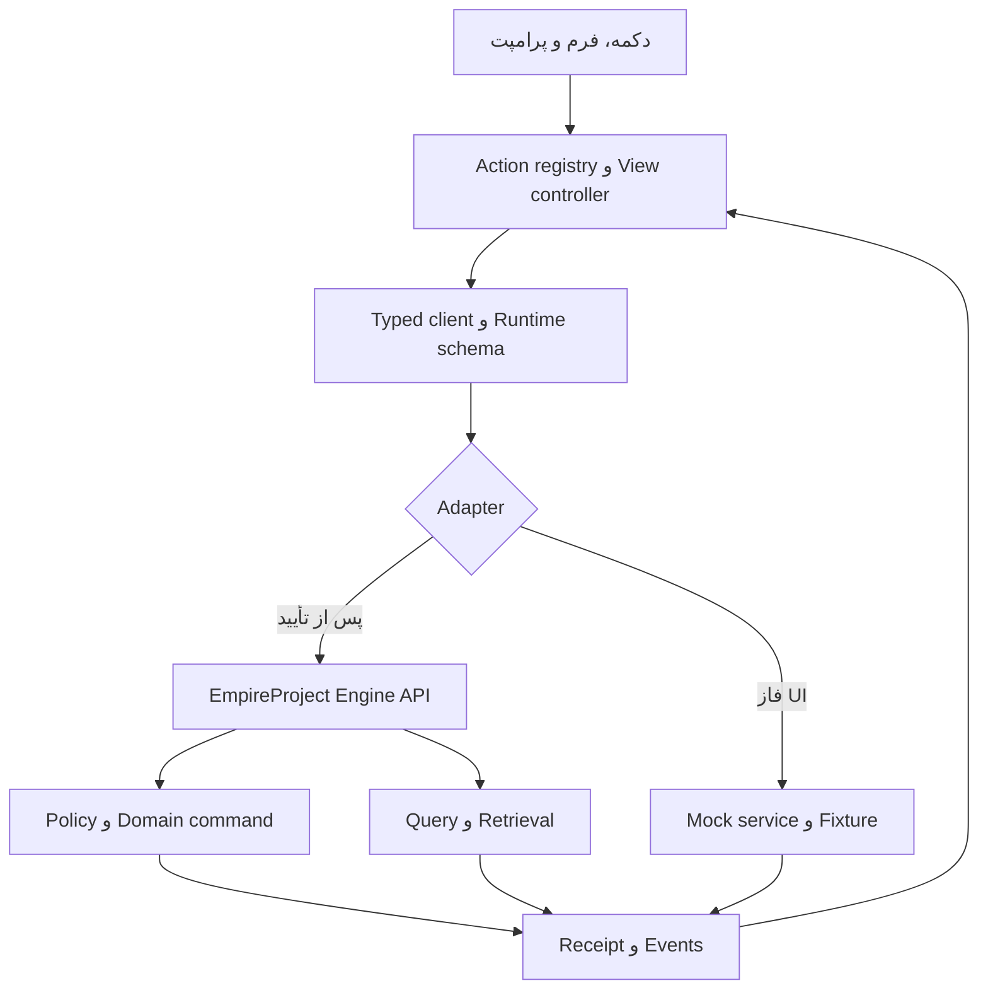

# EmpireProject — معماری تجربه، قرارداد فرانت‌اند و پرامپت اجرایی Codex

نسخه: 3.0 | تاریخ بررسی منابع: 22 اکتبر 2026 | وضعیت: آماده پیاده‌سازی و آزمون UI، پیش از اتصال Engine

**اصل محصول: کاربر قصدش را بیان می‌کند؛ محیط کار، داده و ابزار مناسب همان قصد را جلوی او می‌آورد.**

مثال تعیین‌کننده: «Issueهای باقی‌مانده این اسپرینت را نشان بده» باید صفحه اصلی را به فهرست واقعی همان Issueها تبدیل کند؛ «فقط مسدودها» همان فهرست را محدود کند؛ «روی تایم‌لاین نشان بده» نمایش همان مجموعه را عوض کند. پاسخ متنی کنار صفحه، به‌تنهایی، اجرای این درخواست نیست.

این سند محصول نهاییِ تحقیق و طراحی است، نه گزارش پیاده‌سازی. اعداد سناریوها داده آزمایشی‌اند؛ اهداف عملکرد و کیفیت، معیار پذیرش پیشنهادی‌اند و هنوز اندازه‌گیری نشده‌اند. در فاز فعلی، UI با داده و سرویس شبیه‌سازی‌شده ساخته می‌شود؛ موتور واقعی، اتصال حساب‌ها و ارسال بیرونی در فاز اتصال قرار دارند.

## 0. تصمیم‌های اجرایی و دامنه

| موضوع | تصمیم این سند |
|---|---|
| محصول | Enterprise SaaS برای مدیریت کار، پروژه، برنامه و پورتفولیو؛ متصل به EmpireProject Engine |
| خروجی فعلی | Spec، قرارداد داده و تعامل، طراحی سیستم، معیار پذیرش و پرامپت ساخت فرانت‌اند |
| استک پایه در نبود کد قبلی | React + TypeScript + Vite؛ انتخاب فنی این سند، نه الزام کاربر به یک فناوری خاص |
| پروژه موجود | ابتدا مخزن و AGENTS.md بررسی شود؛ Next.js یا استک سازگار موجود صرفاً برای اجرای این سند تعویض نشود |
| تجربه AI | نوار فرمان دائماً در دسترس + دستیار زمینه‌ای بازشونده + تغییر مستقیم نمای اصلی |
| ظاهر | آبی حرفه‌ای، شیشه محدود در پوسته و پنل‌ها، سطح خوانای نسبتاً مات برای داده؛ Light و Dark هم‌ارز |
| زبان | رابط انگلیسی پیش‌فرض، فارسی و عربی کامل؛ زبان، جهت، تقویم، اعداد و منطقه زمانی مستقل |
| متدها | Scrum، Kanban و مدیریت Predictive/Hybrid؛ فعال‌سازی قابلیت متناسب با پروژه |
| اولویت برنامه‌ریزی سازمانی | وابستگی، Timeline/Gantt، WBS، ریسک و تصمیم؛ EVM فقط در پروژه دارای داده مالی معتبر |
| AI واقعی در این فاز | Adapter و قرارداد آماده؛ سناریوی Mock نباید به‌عنوان هوش عمومی یا اتصال واقعی معرفی شود |
| ادعای هم‌قدرتی با Jira | هدف پوشش دامنه‌های اصلی است؛ ادعای برابری کامل تمام افزونه‌ها و رفتارهای Jira در نمونه اولیه نداریم |

واژه‌های MUST/باید در این سند الزام پذیرش‌اند. پیشنهادهای عددی و انتخاب فناوری با برچسب «هدف طراحی» یا «تصمیم معماری» آمده‌اند. منبع پژوهشی، تصمیم طراحی و فرضیه آزمون از یکدیگر جدا هستند.

## 1. پژوهش: چه چیزی از نارضایتی کاربران باید آموخت؟

### 1.1 روش و حدود شواهد

جست‌وجوی گسترده و هدفمند در Reddit، Atlassian Community، ردیاب عمومی Jira، Hacker News، مستندات رسمی محصول و راهنماهای اصلی انجام شد. «تمام اینترنت» مجموعه بسته و قابل بررسی کامل نیست؛ این سند ادعای سرشماری همه شکایت‌ها ندارد. نظرات خوداظهاری، برای یافتن مسئله و طراحی سناریوی آزمون مفیدند؛ درصد نارضایتی بازار، رابطه علت و معلول یا وضعیت همه نصب‌های Jira را ثابت نمی‌کنند.

شکایت‌های 2021 تا 2024 شاهد تاریخی‌اند؛ نظرات 2025 و 2026 نیز ممکن است به طرح، نسخه، نوع پروژه، افزونه یا rollout متفاوت مربوط باشند. انتساب علت‌هایی مانند فناوری زیرساخت، محل استخدام توسعه‌دهندگان یا استفاده شرکت از AI بدون شاهد مستقل پذیرفته نشده است. مقالات فروشندگان رقیب و افزونه‌ها مبنای اصلی ادعای ضعف محصول نیستند.

سه ورودی محلی بررسی شدند: [A1] یادداشت آموزشی 25 صفحه‌ای Jira 1؛ [A2] یادداشت آموزشی 25 صفحه‌ای Jira 2؛ [A3] سند 21 ایده UX نسخه 2. ارجاع صفحه در این سند، شماره صفحه PDF است. دو PDF، صدای مستقیم بازار جهانی یا مستند رسمی نسخه جاری Cloud نیستند.

### 1.2 تصویر به‌روز رقیب؛ خطای مقایسه با Jira قدیمی

| شاهد رسمی | آنچه واقعاً اعلام شده | اثر بر طراحی EmpireProject |
|---|---|---|
| ناوبری جدید 2025 [W09] | Atlassian بازطراحی ناوبری و نتایج مثبت آزمون‌های خود را گزارش می‌کند | شکایت‌ها با تجربه مثبت برخی کاربران هم‌زمان‌اند؛ ناوبری باید با کار واقعی سنجیده شود |
| List، 27 ژوئیه 2026 [W10] | جست‌وجوی زبان طبیعی، JQL، سلسله‌مراتب، ویرایش درجا و ذخیره نما؛ AI Search در Premium/Enterprise | «جست‌وجو با پرامپت» به‌تنهایی تمایز تازه نیست |
| Board، 27 ژوئیه 2026 [W11] | ویرایش کارت، نمایش Subtask و بارگذاری تدریجی؛ این انتشار مشخص برای team-managed software است | ادعای فقدان این قابلیت‌ها در تمام Jira غلط است؛ عملکرد مستقل آزموده شود |
| Delivery Agent [W12] | خلاصه Standup، بررسی سلامت و گزارش ذی‌نفع؛ وابسته به دسترسی Rovo/Confluence و اتصال کانال | خلاصه‌سازی و گزارش خودکار، قابلیت پایه رقابت شده‌اند |
| ساخت فضا با Rovo [W13] | ساخت ساختار اولیه پروژه از توضیح و منابع، با پیش‌نمایش | ورود فایل باید کیفیت نگاشت، رفع ابهام و ردیابی تغییر بهتری داشته باشد |
| Field Schemes [W14] | ساده‌سازی لایه‌های تنظیم فیلد و نمایش دامنه اثر؛ Screens همچنان باقی‌اند | زنجیره قدیمی جزوه را به‌عنوان وضعیت قطعی همه Cloudها گزارش نکنیم |
| Linear [W15] | فیلتر نما با زبان طبیعی؛ Agent نیز در محصول حضور دارد [W16] | مزیت باید از پیوستگی کامل کار و کیفیت اجرا حاصل شود |

این‌ها اعلام قابلیت در منابع رسمی‌اند؛ فعال‌بودن در حساب خاص، کیفیت عملی یا حل‌شدن همه شکایت‌ها از آن‌ها نتیجه نمی‌شود. تمایز پیشنهادی EmpireProject: **یک محیط پایدار برای پرسش، مشاهده، تصمیم و اقدام؛ با نمایش مستقیم نتیجه در صفحه، داده قابل ردیابی و پشتیبانی جهانی از ابتدا.** اثبات تمایز به UAT وابسته است.

### 1.3 دفتر مسئله: شکایت → درس طراحی → آزمون

| ID | نقش/شاهد | مسئله گزارش‌شده یا مشاهده‌شده | تصمیم طراحی پیشنهادی | معیار آزمون |
|---|---|---|---|---|
| P01 | توسعه‌دهنده، بحث 2021 [W01] | کندی، جابه‌جایی ناگهانی عناصر و نامعلوم‌بودن ذخیره | چیدمان پایدار؛ وضعیت ذخیره صریح؛ پاسخ محلی سریع | متن هنگام Retry گم نشود؛ کنترل زیر اشاره‌گر جابه‌جا نشود |
| P02 | کاربران و ادمین‌ها، بحث ناوبری 2025 [W02] | پنهان‌شدن مسیرها در More و دشواری جابه‌جایی | مسیر ثابت، آخرین نمای پروژه، Pin و فرمان؛ اقدامات رایج قابل مشاهده | بازگشت به فیلتر، انتخاب و Scroll قبلی |
| P03 | ادمین/مشاور باسابقه، آوریل 2026 [W03] | پیدا نکردن عمل آشنا، تغییر اصطلاحات، کنترل‌های پنهان | واژگان ثابت، فرمان با مترادف و چیدمان قابل پیش‌بینی | کاربر قدیمی عمل مرجع را بدون آموزش دوباره پیدا کند |
| P04 | مالک محصول، آوریل 2025 [W04] | تاریخ‌های لغزان ناشی از دامنه ناقص و وضعیت‌های کهنه | نمایش پوشش داده، تغییر دامنه و زمان داده | داده ناقص به پیش‌بینی قطعی تبدیل نشود |
| P05 | ذی‌نفع کسب‌وکار، بحث مارس 2024 [W05] | نیاز به دریافت وضعیت بدون ورود به کار روزانه ابزار | نمای ذی‌نفع و Snapshot قابل اشتراک با ACL مستقل | فقط خروجی مجاز دیده شود؛ لینک عمومی پیش‌فرض نباشد |
| P06 | تیم غیرتکنیکی، گزارش 2026 [W06] | وقت زیاد آموزش ابزار در کنار نیاز به سفارشی‌سازی | واژگان ساده، فرم کوتاه و الگوی نقش؛ عمق در محل نیاز | کاربر غیرتکنیکی درخواست و بازخورد ثبت کند |
| P07 | کاربران اعلان، ردیاب رسمی [W07] | اعلان‌های ریز و تکراری | Digest، ترجیح شخصی و «چرا این اعلان؟» | رویداد تکراری پیام جدید نسازد |
| P08 | توسعه‌دهنده/ادمین، تجربه مثبت 2023 [W08] | با حذف فیلد اضافی و اصلاح Workflow تجربه بهتر شده | انضباط پیکربندی جزئی از محصول است | الگوی جدید بی‌جهت فیلد سراسری نسازد |
| P09 | Scrum Master/تسهیل‌گر، جزوه [A2:1,11–22] | ساخت و تنظیم گزارش به کار اداری تبدیل می‌شود | گزارش آماده متصل به سؤال، Preview زنده و Drill-down | یافتن مانع تا ثبت پیگیری در یک زمینه |
| P10 | ادمین پروژه، جزوه [A1:9,18,21] | AND/OR اشتباه، فیلد ضروری غایب، انتقال ناممکن | شبیه‌ساز قانون و کنترل آمادگی تنظیمات | علت دقیق خطا پیش از انتشار پیدا شود |
| P11 | کاربر فارسی، جزوه [A2:23–24] | راست‌چین‌شدن ناقص و تفاوت Summary با Comment | پشتیبانی بومی BiDi در همه اجزا | ترکیب فارسی، EMP-104، کد و URL درست باشد |
| P12 | همه نقش‌ها، الزام کاربر | جواب AI در چت می‌ماند و کاربر باید نتیجه را دستی پیدا کند | Prompt-to-View در بوم اصلی | «نشان بده» مستقیماً مجموعه واقعی را Render کند |

P09 تا P11 استخراج مسئله از کلاس‌اند؛ نمونه آماری کاربران Scrum Master در اینترنت نیستند. P12 الزام مستقیم محصول است. مشکلات محصول، تنظیم سازمان و رفتار مدیریتی باید جدا ثبت شوند؛ UI به‌تنهایی دامنه مبهم یا سیاست نامناسب سازمان را حل نمی‌کند.

وضعیت [W07] هنگام بررسی «Fixed» است و اعلام تنظیمات جدید اعلان در مارس 2024 دارد؛ از آن به‌عنوان درس تاریخی استفاده می‌کنیم، نه ادعای باقی‌ماندن همان نقص بدون تغییر.

## 2. درس‌های مشخص ضمیمه‌ها و تبدیل آن‌ها به قرارداد

| ID | منبع | نیاز واقعی | الزام EmpireProject |
|---|---|---|---|
| L01 | A1 ص1، 5–17 | آماده‌کردن پروژه بدون دانستن زنجیره Scheme | Project Blueprint با هدف، نوع کار، Workflow، اعضا، دسترسی و Preview مشترک |
| L02 | A1 ص3–5، 16–17 | فرق گروه، نقش و مجوز | Role label از Effective permissions جدا؛ نمایش «چه کاری می‌تواند انجام دهد و چرا» |
| L03 | A1 ص5–7 | ساخت نوع کار و سلسله‌مراتب | Type registry و Hierarchy policy؛ جلوگیری از والد نامعتبر و چرخه |
| L04 | A1 ص7–11 | وضعیت، عمل انتقال، شرط و اعتبارسنجی | Status اسم/حالت؛ Action فعل؛ اعتبارسنجی در زمان درست با ورودی حفظ‌شده |
| L05 | A1 ص9، 21 | اشتباه AND/OR | نمایش جمله + درخت منطق + نمونه مجاز/نامجاز در همان پنل |
| L06 | A1 ص13–15 | فرم متفاوت Create/View/Edit | فرم وابسته به نوع و لحظه؛ برای کار ساده عنوان کافی مگر سیاست ضروری مشخص |
| L07 | A1 ص15 | تنظیم مشترک چند پروژه | Versioned template، فهرست پروژه‌های متأثر و تغییر محلی کنترل‌شده |
| L08 | A1 ص18 | Epic Name لازم ولی نامرئی | Linter تنظیمات: required-hidden ناسازگار، پیش از Publish مسدود شود |
| L09 | A1 ص18–20 | Epic، Component، Sprint و Release | چهار رابطه مستقل؛ Epic معادل فاز یا Release یا Sprint فرض نشود |
| L10 | A1 ص20–21 | Status بدون ستون و کار ناتمام | نگاشت صریح؛ وضعیت نگاشت‌نشده گم نشود؛ بازگرداندن ناتمام به تصمیم Backlog |
| L11 | A1 ص22–23؛ A2 ص2–4 | AC، DoD، خروجی و گزارش | Acceptance Criteria از DoD و شواهد آزمون جدا؛ هدف Sprint با درصد Point یکی نشود |
| L12 | A1 ص24–25 | Resolution و دسترسی سطح Issue | completed/cancelled/duplicate جدا؛ دسترسی رکورد در جست‌وجو، AI و گزارش هم اعمال شود |
| L13 | A2 ص5–10 | JQL و فیلترهای ذخیره‌شده | یک Query Model برای Prompt، فیلتر بصری و حالت پیشرفته؛ تبدیل بدون حذف معنای شرط |
| L14 | A2 ص11–20 | تنظیم گزارش با خروج و بازگشت | Builder با Preview زنده، Draft و Undo محلی؛ منبع/شاخص/گروه‌بندی کنار هم |
| L15 | A2 ص21–22 | از نمودار به تحلیل گلوگاه | هر عدد به آیتم‌ها باز شود؛ مشاهده، فرضیه علت و اقدام پیشنهادی جدا |
| L16 | A2 ص22؛ A1 ص25 | صورتجلسه، تصمیم، Retro و پیگیری | Knowledge/Decision/Action روی موجودیت مشترک؛ از صورتجلسه به کار و برعکس |
| L17 | A1 ص24؛ A2 ص25 | اتصال ارتباط و Automation | Event-to-channel با جلوگیری از Loop و نمایش گیرنده/نتیجه |
| L18 | A3 بخش21 | فایل ناقص و پرسش تعاملی | Import workspace با نگاشت، سؤال ردیفی، پیش‌نمایش و ثبت قابل ادامه |

### 2.1 مواردی که نباید از کلاس به قاعده عمومی تبدیل شوند

Scrum Guide مرجع پاسخگویی‌های Scrum است، نه شیوه نصب و مدیریت Jira. در آن Scrum Master مدیر تخصیص همه کارها نیست؛ تیم خودمدیریت است، Product Owner یک پاسخگویی مشخص دارد و Sprint Review دروازه اجباری انتشار نیست. قالب User Story، Story Point، Planning Poker و فرم تأیید مشتری را نباید الزام جهان‌شمول Scrum نامید. [W17]

در محصول: نقش Scrum Master خودبه‌خود Admin نشود؛ تیک AC یا Done شدن Subtask اثبات کیفیت کل Story نباشد؛ نسبت 13/21 فقط نسبت Point با تعریف معین است، نه «62٪ تحقق هدف». Increment، خروجی قابل استفاده با استاندارد کیفیت مشترک است. بررسی هدف، قضاوت و شاهد جدا می‌خواهد. فرمول یا نگارش JQL جزوه بدون اعتبارسنجی کپی نشود.

مسیرهای نصب افزونه، Reindex، عملیات Server/Data Center و روش‌های غیراصلی مجوز افزونه، بخشی از محصول Cloud ما نیستند. قابلیت لازم با API و وابستگی دارای مجوز معتبر طراحی شود. هیچ الزام عمومی برای نصب افزونه نام‌برده در کلاس نداریم.

## 3. اصول محصول و نقش‌ها

### 3.1 قواعدی که در همه صفحه‌ها اجرا می‌شوند

1. **یک داده، چند نما:** Table، Board، Timeline و گزارش، نمای یک Query و مجموعه مشترک‌اند.
2. **پرامپت یک ورودی عملیاتی است:** می‌تواند نما، انتخاب، پیش‌نویس یا فرمان تولید کند؛ نوع نتیجه روشن باشد.
3. **کار مستقیم همیشه ممکن است:** ویرایش وضعیت ساده نباید به چت نیاز داشته باشد.
4. **سادگی از ترتیب و پیش‌فرض خوب می‌آید:** یک منوی پنهان برای هر قابلیت، راه‌حل شلوغی نیست.
5. **اقدام پرتکرار پیدا باشد:** روی ردیف، وضعیت/مسئول/انتخاب؛ عملیات نادر در More. Hover تنها راه کشف نباشد.
6. **پوسته ثابت، محتوای متناسب:** AI ترتیب ناوبری و محل دکمه‌ها را خودسرانه عوض نکند.
7. **کاربر باید بداند چه چیزی تغییر کرد:** فیلتر موقت، پیش‌نویس، تغییر ذخیره‌شده و ارسال بیرونی چهار مفهوم جدا هستند.
8. **اعداد از محاسبه، توضیح از مدل:** شمارش، مجوز، تاریخ و قانون توسط منطق قطعی؛ LLM برای فهم و پیشنهاد.
9. **خطا بخشی از طراحی است:** حفظ ورودی، علت قابل فهم، ادامه از محل شکست و کمک زمینه‌ای AI.
10. **شفافیت داده:** زمان آخرین دریافت، پوشش، منابع و داده مفقود؛ صفر با نامعلوم متفاوت است.
11. **AI فراگیر و قابل کنارگذاشتن:** دسترسی در تمام بخش‌ها؛ بدون پنل دائماً باز، توصیه مزاحم یا اجبار به گفتگو.
12. **قدرت سازمانی بدون انتقال بار پیکربندی به همه:** سیاست و گزارش پیچیده برای نقش مجاز، عملیات ساده برای بقیه.

### 3.2 فضای کار هر نقش

| نقش | پرسش مهم | نمای پیش‌فرض پیشنهادی | اقدام شاخص | حدود |
|---|---|---|---|---|
| Developer | روی چه چیزی کار کنم و چه مانعی دارم؟ | کارهای من، بررسی‌ها و وابستگی | بازکردن کار، ثبت مانع، ارسال برای Review | ارزیابی فرد با تعداد Ticket/Point انجام نشود |
| QA | چه چیزی آماده آزمون است و شاهد کجاست؟ | صف آزمون با AC و نتیجه تست | ثبت نتیجه، Bug مرتبط، بازگشایی طبق قانون | AI بدون نتیجه ابزار، تست را Passed نکند |
| Scrum Master | جریان و هدف Sprint کجا در خطر است؟ | Age، Blocker و پیگیری Retro | تسهیل رفع مانع و ساخت پیگیری | نقش تسهیل‌گر با Admin یکی نیست |
| Product Owner | چه چیزی بیشترین ارزش و آمادگی را دارد؟ | Goal و Backlog مرتب | پالایش، اولویت، پیشنهاد Sprint | اولویت نهایی خودکار تحمیل نشود |
| Project/Program Manager | کدام تعهد یا وابستگی نیازمند تصمیم است؟ | Milestone، Risk، Dependency و تغییر دامنه | تحلیل سناریو و ثبت تصمیم | پیش‌بینی با تعهد رسمی یکی نشود |
| Stakeholder/Client | چه تحویل شد و چه تصمیمی از من لازم است؟ | خروجی و تصمیم‌های مجاز | بازخورد یا پاسخ به تصمیم | کار داخلی و یادداشت محرمانه پنهان بماند |
| Admin/Security | چه کسی چه دسترسی دارد و چه تغییری اثر می‌گذارد؟ | تنظیمات مؤثر، Audit و اتصال‌ها | شبیه‌سازی/انتشار Policy | تغییر Lens نقش، تغییر دسترسی نیست |

## 4. دامنه اینترپرایز و مرز فاز UI

P0 و P1 هر دو فرانت‌اند هستند. P0 یک برش کامل برای UAT اولیه؛ P1 تکمیل دامنه UI پیش از قرارداد نهایی Engine است. P2 فقط پس از تأیید UI، اتصال و سخت‌سازی موتور را اجرا می‌کند.

| دامنه | P0: قابل تعامل کامل | P1: UI تکمیلی | P2: مسئولیت موتور |
|---|---|---|---|
| کار و Workflow | CRUD، Inline، Parent، Status/Resolution، Comments، Mock attachment | Workflow editor، فیلد سفارشی، Bulk پیشرفته، Worklog | تراکنش، قواعد و فایل واقعی |
| Prompt-to-View | Query/Filter/Group/View/Open/Back با قرارداد واقعی | Compare، Portfolio و ترکیب گزارش | Semantic planner، Query executor و Retrieval |
| Scrum/Kanban | Backlog، Goal، Sprint، Board، WIP و داده گزارش | چندتیمی، ظرفیت، نسخه و گزارش سفارشی | Event history و محاسبات کامل |
| برنامه‌ریزی | Timeline و وابستگی ساده با Preview | Gantt کامل، WBS، Baseline، Risk، EVM اختیاری | Scheduling/Forecast و منابع مالی |
| AI/فایل | Assistant، Diff، فعالیت، CSV/XLSX و سؤال ردیفی | سند/OCR، ساخت Blueprint و Policy پیشنهادشده | LLM، ابزارها، پردازش امن و عملیات طولانی |
| دانش | سند، Source citation و Decision مرتبط | نسخه، جست‌وجوی ترکیبی و درس‌آموخته | ACL-aware RAG و Index lifecycle |
| ارتباط | تایم‌لاین پیام و شبیه‌سازی Draft/Send/Fail | Preferences، Thread binding و Connector settings | OAuth، Webhook و Provider adapter |
| سازمان | نقش‌های آزمایشی، Tenant switch آزمایشی، Effective access | SSO/SCIM settings، Audit، Agent policies، Region/Retention | Identity، Enforcement، Residency و Retention واقعی |

مرز مهم: نمایش UI دسترسی، اثبات امنیت سرور نیست. نمایش تنظیم نگهداری داده، اجرای نگهداری نیست. هر Capability در قرارداد باید `mock / available / unavailable / requiresSetup` داشته باشد؛ در محیط Demo نشان کوچک و ثابت «داده آزمایشی» کافی است.

## 5. معماری اطلاعات و حفظ زمینه

### 5.1 پوسته

| ناحیه | محتوای دائمی | رفتار |
|---|---|---|
| Header | سازمان/پروژه جاری، جست‌وجو و فرمان، ایجاد، فعالیت، پروفایل | یک Header؛ بدون نوار دوم تکراری |
| Navigation | امروز، کارها، پورتفولیو، دانش | برچسب کوتاه، Pin و وضعیت انتخاب؛ Settings پایین ناوبری |
| Main workspace | نتیجه سؤال یا نمای انتخابی | محل اصلی تغییر بعد از پرامپت |
| Context panel | جزئیات کار یا شاهد | همان فهرست و Scroll پشت آن حفظ شود |
| Assistant panel | گفتگو، زمینه و پیش‌نویس | بسته‌شونده، قابل تغییر اندازه و قابل Pin |
| Activity tray | اجرای فرمان، سؤال‌های منتظر، خطا و رسید | مستقل از بازبودن چت |

«ورودی‌ها» از سند A3 به مقصد مشترک File/Request intake در Create و Command Bar تبدیل می‌شود؛ «فعالیت» در Tray سراسری حفظ می‌شود. فضای «برنامه» در «کارها» است که Backlog، Sprint، Board، List و Timeline را روی داده مشترک ارائه می‌دهد. داشبورد قابل ساخت از امروز/پورتفولیو باز می‌شود، نه با افزودن منو برای تک‌تک نمودارها.

### 5.2 قرارداد مسیر

```text
/t/:tenantId/today
/t/:tenantId/p/:projectId/work?view=:viewId
/t/:tenantId/p/:projectId/work/:workItemId
/t/:tenantId/portfolio/:portfolioId
/t/:tenantId/knowledge/:documentId
/t/:tenantId/imports/:importJobId
/t/:tenantId/settings/:section
/t/:tenantId/activity/:runId
```

این فهرست مسیر است، نه وایرفریم. شناسه‌ها باید با Router encode شوند. Prompt خام یا متن محرمانه در URL، Telemetry یا history مشترک ذخیره نشود. نمای بزرگ/حساس با شناسه ذخیره‌شده و ACL ارجاع داده شود. URL ساده فقط Query غیرحساس و مجاز را می‌تواند encode کند.

هر ViewState شامل scope، query، sort، group، columns، density، selected IDs، panel و scroll anchor است. Back مرورگر و «نمای قبل» این وضعیت را بازمی‌گردانند. بازکردن Deep link بدون history نیز باید صفحه کامل قابل استفاده بسازد.

## 6. الزام محوری: Prompt-to-View و محیط پاسخ‌گو به قصد کاربر

### 6.1 قرارداد رفتاری

**UX-AI-001:** فعل‌های «نشان بده»، «بیار»، «فیلتر کن»، «مقایسه کن» و «روی نمودار ببینم» باید نتیجه را در Main workspace نمایش دهند. دستیار می‌تواند توضیح یک‌خطی بدهد؛ نتیجه صرفاً Bubble یا لینک به صفحه‌ای که کاربر باید خودش بسازد نباشد.

| درخواست | تغییر الزامی صفحه | متن کمکی و تعامل بعدی |
|---|---|---|
| «Issueهای باقی‌مانده این Sprint را نشان بده» | List با ستون Key، عنوان، Status، Owner، Age و Blocker؛ Query Sprint جاری | «این نما کارهای باز Sprint 12 را نشان می‌دهد» + فیلترهای قابل ویرایش |
| «فقط مسدودها» | تقاطع Query جاری با blocked=true | حفظ Scope و Group قبلی؛ Chip جدید |
| «بر اساس مسئول مرتب کن» | Sort روی Owner؛ اگر «گروه‌بندی» خواسته Group | افراد بدون مسئول در گروه روشن |
| «این‌ها را روی برد نشان بده» | همان Query، Renderer=Board | تعداد و دامنه یکسان با List |
| «روی Timeline نشان بده» | همان Query، Renderer=Timeline | کار بدون تاریخ در بخش «زمان‌بندی نشده»؛ حذف خاموش ممنوع |
| «کدام وابستگی تحویل را نگه داشته؟» | Dependency view با کارهای شاهد و مانع انتخاب‌شده | علت مستند/فرضیه جدا؛ گراف محدود و قابل گسترش |
| «چرا EMP-104 مانده؟» | جزئیات EMP-104 و شواهد زمانی در کنار نمای فعلی | وضعیت، آخرین رویداد و علت ثبت‌شده؛ اگر نامعلوم، صریح |
| «این هفته چه چیزی تحویل شد؟» | فهرست completed با بازه دقیق و واحد زمان | Cancelled و Duplicate به‌عنوان تحویل شمرده نشوند |
| «همین نما را ذخیره کن» | Dialog کوچک نام/دامنه اشتراک یا ذخیره شخصی طبق قصد | اشتراک سازمانی از ذخیره شخصی نتیجه گرفته نشود |
| «حالا این 3 مورد را برای Review بفرست» | انتخاب 3 رکورد و Form/Diff انتقال در همان صفحه | عملیات Write؛ اعتبارسنجی و رسید لازم |
| «برگرد به نمای قبلی» | بازیابی ViewState قبلی | هیچ رکورد پروژه تغییر نمی‌کند |

«مانده» پیش‌فرض یعنی Status category در `todo/in_progress` و رکورد آرشیو نشده؛ این تعبیر در Chip آشکار می‌شود. «تحویل‌نشده» ممکن است لغوشده را هم شامل کند و با «باز» یکی نیست. در پروژه دارای چند Sprint فعال، Scope جاری معتبر ملاک است؛ اگر Scope روشن نیست، یک انتخاب کوتاه Sprint لازم است. اگر کاربر «مانده پروژه» بگوید، Sprint filter قبلی باید طبق قصد جدید برداشته شود و تغییر Scope نشان داده شود.

### 6.2 از زبان به نمای معتبر



LLM نام Component، JavaScript، SQL خام یا HTML قابل اجرا تولید نمی‌کند. یک `UIIntent` محدود و اعتبارسنجی‌شده پیشنهاد می‌دهد. Renderer فقط از Component registry تأییدشده می‌سازد. محتوای سند بازیابی‌شده اجازه تغییر مسیر، اجرا یا ارسال ایجاد نمی‌کند. این انتخاب معماری از الگوی UI مبتنی بر خروجی ساخت‌یافته الهام دارد [W27]؛ قرارداد زیر طراحی اختصاصی EmpireProject است.

### 6.3 مدل Query و UIIntent

```ts
type EntityId = string;
type Scalar = string | number | boolean | null;
type QueryField =
  | "projectId" | "sprintId" | "statusCategory" | "resolution"
  | "assigneeId" | "blocked" | "dueDate" | "completedAt"
  | "priority" | "typeId" | "parentId" | "archived";
type QueryNode =
  | { kind: "all" | "any"; children: QueryNode[] }
  | { kind: "not"; child: QueryNode }
  | { kind: "predicate"; field: QueryField;
      op: "eq" | "in" | "lt" | "lte" | "gte" | "isNull";
      value: Scalar | Scalar[] };
type Renderer = "list" | "board" | "timeline" | "gantt"
  | "dependencies" | "chart" | "comparison";
interface ViewSpec {
  schemaVersion: "1.0";
  scope: { tenantId: EntityId; projectIds: EntityId[]; sprintId?: EntityId };
  query: QueryNode;
  renderer: Renderer;
  columns: string[];
  groupBy?: QueryField;
  sort: Array<{ field: QueryField | "key"; direction: "asc" | "desc" }>;
  title: string;
  locale: string;
  timeZone: string;
  calendar: string;
}
type UIIntent =
  | { kind: "show_view"; requestId: string; baseViewRevision: number;
      view: ViewSpec; history: "push"; focus: "resultsHeading" }
  | { kind: "open_entity"; requestId: string; entityId: EntityId;
      presentation: "panel" | "page" }
  | { kind: "ask_clarification"; requestId: string; question: string;
      options: Array<{ id: string; label: string }> }
  | { kind: "propose_command"; requestId: string; commandDraftId: string }
  | { kind: "restore_view"; requestId: string; historyEntryId: string };
```

UIIntent در زمان اجرا با JSON Schema/Zod چک شود؛ TypeScript به‌تنهایی اعتبارسنجی ورودی نیست. Registry، اعتبار field/op/value و renderer را کنترل کند. حد عمق Query برابر 8 و تعداد Predicate برابر 50، هدف اولیه قابل تنظیم این قرارداد است. Custom field فقط از Schema مجاز پروژه resolve می‌شود؛ هر string دلخواه پذیرفته نیست.

Scope ارسالی Frontend داده غیرقابل اعتماد است. Engine از Session و Permission واقعی، Tenant و دسترسی را کنترل می‌کند. تبدیل Prompt به Query و اجرای Query دو مرحله‌اند؛ نتیجه 27 مورد را مدل زبانی نباید تخمین بزند.

نمونه قراردادی برای «مانده‌های Sprint 12»؛ تمام شناسه‌ها داده آزمایشی هستند:

```json
{
  "kind": "show_view",
  "requestId": "req_demo_014",
  "baseViewRevision": 7,
  "history": "push",
  "focus": "resultsHeading",
  "view": {
    "schemaVersion": "1.0",
    "scope": {"tenantId": "tenant_demo", "projectIds": ["project_pay"], "sprintId": "sprint_12"},
    "query": {
      "kind": "all",
      "children": [
        {"kind": "predicate", "field": "projectId", "op": "eq", "value": "project_pay"},
        {"kind": "predicate", "field": "sprintId", "op": "eq", "value": "sprint_12"},
        {"kind": "predicate", "field": "statusCategory", "op": "in", "value": ["todo", "in_progress"]},
        {"kind": "predicate", "field": "archived", "op": "eq", "value": false}
      ]
    },
    "renderer": "list",
    "columns": ["key", "title", "status", "assignee", "workItemAge", "blocker"],
    "sort": [{"field": "priority", "direction": "desc"}],
    "title": "کارهای باقی‌مانده Sprint 12",
    "locale": "fa-IR",
    "timeZone": "Asia/Tehran",
    "calendar": "persian"
  }
}
```

Priority در مثال یک ordinal تعریف‌شده در پروژه است؛ مرتب‌سازی الفبایی نام اولویت معتبر نیست. فیلدهای نمایشی `status/assignee/workItemAge/blocker` با Registry به projection داده نگاشت می‌شوند.

### 6.4 حفظ کنترل و پیوستگی

- نمایش و فیلترِ درخواستی بدون Confirm اضافی اجرا شود؛ چون تغییر داده پروژه نیست.
- نمای شخصی موقت است؛ تغییر Shared dashboard، Default view یا Saved filter نیازمند فرمان ذخیره است.
- هنگام بازبودن ویرایش ناتمام، پیش‌نویس محلی حفظ شود. اگر کنترل نتواند Draft را حفظ کند، قبل از ترک همان ورودی گزینه ماندن/ذخیره ارائه کند.
- پاسخ دیررس به درخواست قبلی نباید نمای حاصل از درخواست تازه را بازنویسی کند؛ `requestId + baseViewRevision` و AbortController لازم است.
- «این‌ها» به Query و ResultSet جاری resolve می‌شود؛ برای Write گروهی، TargetSet ثابت و versioned ساخته شود. نتیجه جدیدی که بعداً وارد فیلتر شده بی‌صدا به عملیات اضافه نشود.
- کارت و Count از یک Snapshot مجاز باشند؛ «27 مورد» در Header و 21 مورد غیرقابل توضیح در جدول قابل قبول نیست. Pagination و شمارش تقریبی برچسب دارند.
- اگر داده صفر است، Empty state همراه فیلترهای فعال؛ اگر دسترسی/اتصال قطع است، Error state؛ این‌ها معادل نیستند.
- از آخرین نمای مجاز می‌توان در خطای اتصال با برچسب «آخرین داده دریافتی» استفاده کرد؛ پس از لغو مجوز، داده Cache پاک شود.
- Prompt اصلی، اصلاح Query و انتخاب‌های کاربر در History خصوصی قابل بازبینی باشند؛ URL و Analytics حاوی متن حساس نباشند.
- Screen reader تغییر تعداد و عنوان را اعلام کند؛ Focus به عنوان نتیجه برود، مگر کاربر در حال تایپ درخواست بعدی است.
- در «فقط توضیح بده و صفحه را عوض نکن» همین خواسته رعایت شود؛ تحلیل پس‌زمینه هم بدون قصد کاربر صفحه را جابه‌جا نکند.

### 6.5 سناریوی طلایی داده آزمایشی

Fixture Sprint 12 دقیقاً 12 WorkItem قابل مشاهده دارد: 5 completed، 1 cancelled، 6 باز؛ از 6 باز، 2 blocked و یکی بدون موعد. دو رکورد محرمانه دیگر فقط در Fixture سمت Mock executor وجود دارند و به کاربر عادی تحویل داده نمی‌شوند.

1. روی Today: «Issueهای مانده این اسپرینت را نشان بده» → Main workspace با 6 ردیف، نه 7؛ Cancelled باز محسوب نمی‌شود.
2. «فقط مسدودها» → 2 ردیف، Chip مسدود.
3. «بر اساس مسئول گروه‌بندی کن» → همان 2 رکورد در گروه‌های واقعی.
4. «تایم‌لاینش کن» → همان دامنه؛ رکورد بدون تاریخ در Unscheduled باقی می‌ماند.
5. «EMP-104 را باز کن» → Drawer همان رکورد؛ زمینه و Scroll حفظ شود.
6. «برگرد» → بازگشت دقیق به نمای پیشین؛ وضعیت هیچ Issue عوض نشده باشد.
7. «این دو تا را Done کن» → مسیر Write با DoD/Transition validation؛ نمایش شش ردیف یا پاسخ متنی موفقیت، جای اجرای دو فرمان را نگیرد.

این سناریو اولین معیار پذیرش محصول است؛ پروژه‌ای که آن را ندارد، حتی با ظاهر زیبا، P0 را پاس نمی‌کند.

## 7. مشخصات صفحه‌ها و وایرفریم معنایی

وایرفریم‌ها با جدول ناحیه و رفتار بیان شده‌اند؛ زیبایی نهایی با Tokenها و ارزیابی بصری بخش 13 ساخته می‌شود. کارت واحد مناسب همه داده‌ها نیست: فهرست پرتعداد، ردیف می‌خواهد؛ مقایسه، جدول؛ وابستگی، گراف؛ و تصمیم، کارت جمع‌وجور.

### 7.1 امروز / Today

| ناحیه به ترتیب خواندن | محتوا | رفتار |
|---|---|---|
| بالای صفحه | پروژه، تاریخ و «چه چیزی را می‌خواهی پیش ببری؟» | Command Bar یک‌خطی با ضمیمه؛ بدون Hero بزرگ |
| خلاصه کم‌ارتفاع | هدف جاری، تازگی داده، حداکثر سه سیگنال مرتبط | هر عدد فهرست همان کارها را باز کند |
| بخش اصلی | موضوع‌های نیازمند توجه با شاهد و اقدام | برای هر موضوع یک اقدام اصلی، یک مسیر دیدن شاهد |
| بخش دوم | کارهای شخص یا تیم متناسب با Lens | ردیف متراکم و قابل تنظیم |
| پنل اختیاری | شاهد یا Assistant | با بازشدن، محتوا زیر Overlay ناخوانا نشود |

یک موضوع قابل اقدام شامل عنوان، شدت همراه متن، شاهد، عدم قطعیت، اقدام و زمان داده است. نمونه: «3 کار بیش از 2 روز در Review مانده‌اند»؛ توضیح «کمبود Reviewer» فقط در صورت شاهد علت قطعی است. Dismiss/ساکت‌کردن پیشنهاد، تنظیم ترجیح شخصی است و کار را Done نمی‌کند. پاسخ «کارهای مانده را نشان بده» این صفحه را به نمای کارها می‌برد؛ کاربر در همان چت محبوس نمی‌شود.

### 7.2 کارها / List و Backlog

Header نمای کارها: عنوان، Scope chips، View switcher و Create. Toolbar: فیلتر، گروه‌بندی، مرتب‌سازی و Columns. عملیات دسته‌ای فقط بعد از Selection ظاهر شود. فهرست از کل عرض مفید استفاده کند؛ فضای سفید بزرگ میان ردیف‌ها ایجاد نشود.

هر ردیف در حالت عادی: Selection، Key، Type، عنوان، Status، Assignee و حداکثر دو نشان مرتبط. Deadline فقط وقتی موجود یا مرتبط است؛ همه فیلدهای خالی به Badge تبدیل نشوند. آیکون بدون Tooltip و accessible name مجاز نیست. Status و Assignee با یک کلیک وارد ویرایش شوند؛ انتخاب مقدار تعامل جداست.

Backlog همان مجموعه WorkItem با سیاست ترتیب است. گزینه‌های ثبت Quick add، تبدیل متن به کار، Import و Multi-select وجود دارند. نقص AC و وابستگی با نشان قابل فهم دیده شود؛ «Ready» یک Policy تیمی قابل تنظیم است، نه شرط ساخت اولیه تمام کارها. Reorder فهرست فیلترشده باید معنای واضح «قبل/بعد از کدام رکورد در ترتیب اصلی» داشته باشد؛ اگر این معنا حل نمی‌شود، قابلیت غیرفعال با توضیح باشد.

### 7.3 جزئیات WorkItem

| لایه | محتوای پیش‌فرض | جزئیات قابل گسترش |
|---|---|---|
| Header | Key قابل کپی، عنوان، Status و عمل بعدی مجاز | Archive، Duplicate، Move و History |
| مشخصات ضروری | Owner، Priority، Parent، Sprint/Release در صورت ارتباط | Custom fields، Component، Labels، Watchers |
| بدنه | توضیح، AC و فایل مرتبط | DoD و شواهد، تست‌ها، Subtasks |
| همکاری | Activity timeline با فیلتر | Comments، Decisions، Channel messages و Audit خلاصه |
| AI | «درباره این کار بپرس» و پیشنهاد مرتبط | بازنویسی، تحلیل مانع، استخراج و تغییر مجاز |

Drawer در دسکتاپ 480 تا 720px؛ در عرض ناکافی، صفحه کامل با Back به زمینه قبلی. بستن با Escape فقط اگر Draft حفظ شده؛ Focus به ردیف مبدا برگردد. برای اسناد بلند، مسیر Full page موجود باشد. ویرایش عنوان خودکار ذخیره‌شونده می‌تواند `saving/saved/failed/conflict` نشان دهد؛ محتوای بلند Draft با وضعیت ذخیره روشن داشته باشد. متن کاربر در خطای شبکه پاک نشود.

اگر Issue و Assistant هم‌زمان لازم‌اند، زیر 1440px یک پنل زمینه‌ای با Tabs «جزئیات / دستیار» استفاده شود؛ سه ستون تنگ و ناخوانا نسازید. بالای 1600px، دو پنل فقط با اقدام کاربر Pin شوند و حداقل عرض Main رعایت شود.

### 7.4 Board

- عنوان ستون، تعداد کل مجاز و WIP limit روی Header؛ تعداد بارگذاری‌شده از کل جدا.
- Collapse ستون و Swimlane، تراکم Compact/Comfortable و فیلتر ثابت.
- Card: عنوان، Key، Owner، Status معنایی/Blocker و یک نشانه موعد مرتبط؛ اطلاعات بیشتر با Expand.
- Drag تنها راه انتقال نیست؛ منوی «انتقال به» و کیبورد هم لازم‌اند.
- Drop نامعتبر پیش از ارسال دلیل داشته باشد. اگر Transition داده لازم دارد، Form کوچک باز شود؛ UI هنوز انتقال را قطعی اعلام نکند.
- optimistic move فقط برای انتقال ساده با Policy شناخته‌شده؛ خطا باعث بازگرداندن موضع و حفظ توضیح می‌شود.
- WIP متناسب با کل محدوده Board محاسبه شود؛ اعمال فیلتر شخصی، ظرفیت ظاهری آزاد نسازد. اگر مجوز شمارش کل وجود ندارد، عدد نامعلوم و Enforcement سرور حفظ شود.
- ستون‌های «شناور» یعنی Header چسبان، Collapse و جابه‌جایی قابل کنترل؛ حرکت خودکار و تزئینی ستون‌ها ممنوع.

### 7.5 Import workspace

| ناحیه | محتوا | عمل |
|---|---|---|
| بالا | فایل/Sheet، مقصد، زمان Snapshot و سیاست ثبت | تعویض مقصد با اعتبارسنجی دوباره |
| Main | جدول منبع و مقادیر نگاشت‌شده | فیلتر آماده/نیازمند پاسخ/خطا/ثبت‌شده |
| کنار | Mapping و سؤال‌های گروه‌بندی‌شده | پاسخ درجا، Apply به دامنه مشخص |
| پایین | شمارش و اقدام متناسب با دستور | بررسی، ثبت مجاز، توقف مراحل بعدی یا Retry |

Preview فایل بزرگ Virtualized است، اما Validation روی همه ردیف‌ها انجام می‌شود. فایل و نسخه منبع تا پایان Job ثابت‌اند؛ تغییر فایل به معنی Job revision جدید است.

### 7.6 پورتفولیو و گزارش ذی‌نفع

Main: پروژه‌ها/برنامه‌ها با Goal، Milestone، Owner، Risk، آخرین Update و Coverage. انتخاب یک ریسک، کارها و وابستگی‌های شاهد را کنار همان صفحه نشان دهد. Traffic light بدون تعریف و تاریخ داده نمایش داده نشود. نمای ذی‌نفع شامل «تحویل‌شده»، «بعدی»، «ریسک/نیاز به تصمیم» و «تصمیم‌های منتظر من» است؛ ریزفیلدهای مهندسی پیش‌فرض نمایش داده نشوند.

Report snapshot با تاریخ تهیه، دامنه دسترسی، تعریف شاخص و ارتباط با رکوردها ذخیره شود. تغییر داده زنده، گزارش امضاشده/منتشرشده قدیمی را بی‌صدا بازنویسی نکند. لینک زنده و Snapshot دو خروجی جدا هستند.

### 7.7 Dashboard builder

Dashboard شخصی‌سازی‌شونده از ویجت‌های Registry ساخته شود: Work list، Flow chart، Milestone، Decision، Risk، Goal و Activity. هر ویجت شامل Query، MetricDefinition، ChartType، Layout و Data freshness است. Drag/Resize همراه کنترل «بالا/پایین/عرض» برای کیبورد.

Builder سه بخش کنار Preview دارد: «چه داده‌ای؟»، «چه سنجه‌ای؟»، «چه نمایی؟». Prompt «روند ورود و اتمام هشت هفته اخیر را نشان بده» ابتدا گزارش را در Main باز کند؛ «به داشبورد اضافه کن» آن را به تغییر ذخیره‌شده تبدیل کند. Chart type ناسازگار با داده، پیشنهاد اصلاح بگیرد. رنگ‌بندی و فرمت از Design system؛ LLM رنگ جدید یا Chart JavaScript نسازد.

### 7.8 تنظیمات

پنج گروه: «افراد و دسترسی»، «نوع کار و جریان»، «فیلد و قالب»، «اتصال و AI»، «سازمان و ممیزی». جست‌وجوی تنظیمات با مترادف و توضیح اثر وجود داشته باشد. Project settings و Organization settings مرز واضح دارند ولی کاربر برای فهم خطا بین آن‌ها سرگردان نمی‌شود: پنل تنظیم مؤثر، منشأ و دسترسی لازم را نشان می‌دهد.

Publish تنظیمات: Draft → Validation → Impact preview → انتشار مجاز. نمایش پروژه‌ها/کارهای متأثر، Mapping وضعیت‌های حذف‌شده و نسخه قبلی ضروری است. Rollback تنظیم، الزاماً Rollback همه داده‌های تغییرکرده نیست؛ اثرش باید پیش‌نمایش شود.

## 8. Scrum، Kanban، Gantt و مدیریت پروژه

### 8.1 Scrum

Product Goal، Sprint Goal، Sprint Backlog و DoD در داده و UI جای مشخص دارند. Sprint Planning با «هدف، کارهای پیشنهادی، وابستگی، ظرفیت موجود» آغاز شود. Estimate مدل فقط پیشنهاد است؛ مسئول و تعهد زمانی از متن مبهم جعل نشوند. Daily view بر پیشرفت به سمت هدف و مانع متمرکز است. Review خروجی و Feedback را به Backlog متصل می‌کند؛ Retro حداکثر چند اقدام بهبود قابل پیگیری با Owner و موعد توافق‌شده دارد.

Start sprint: هدف، تاریخ/Time zone، مجموعه منتخب و هشدار آمادگی. Close sprint: نتایج، WorkItemهای ناتمام و مقصد پیشنهادی؛ منتقل‌کردن همه ناتمام‌ها به Sprint بعدی پیش‌فرض قطعی نیست. تغییر دامنه بعد از شروع با رویداد و دلیل ثبت شود. در چند تیم، Sprintها هویت و تقویم مستقل دارند؛ Sprint یک ستون وضعیت نیست.

### 8.2 Kanban و Flow

مرز Started/Finished در Definition of Workflow ذخیره شود. چهار سنجه پایه WIP، Throughput، Work Item Age و Cycle Time با همان مرزها تعریف می‌شوند؛ SLE شامل زمان و احتمال و مبتنی بر داده مناسب است. [W18]

UI باید Policy ستون، محدودیت WIP، Age، Block reason و مسیر Escalation را نشان دهد. کار Blocked اگر شروع شده و تمام نشده، از WIP خارج نمی‌شود. Class of service مانند Expedite Policy واضح دارد؛ رنگ قرمز برای همه کارها جای اولویت را نگیرد. عبور از WIP اگر سازمان مجاز کرده، با دلیل و Audit انجام شود؛ هشدار را با محدودیت سخت یکسان نکنید.

### 8.3 قرارداد سنجه‌ها

| سنجه | محاسبه/معنا در محصول | خطای ممنوع |
|---|---|---|
| WIP | تعداد شروع‌شده و پایان‌نیافته در Scope و Snapshot مشخص | شمارش فقط ردیف‌های صفحه جاری |
| Work Item Age | now - startedAt برای کار جاری | استفاده از createdAt بدون توضیح |
| Cycle Time | finishedAt - startedAt؛ سیاست Reopen و تقویم مشخص | مقایسه داده با مرزهای متفاوت |
| Lead Time | finishedAt - requestedAt یا committedAt با عنوان صریح | یکی‌گرفتن با Cycle Time |
| Throughput | شمارش خروج از سیستم؛ breakdown بر اساس Resolution | نامیدن همه خروج‌ها به‌عنوان ارزش تحویل‌شده |
| Delivered count | completed؛ cancelled/duplicate جدا | سبزبودن Status معادل تحویل موفق |
| Burndown | Remaining scope over time با واحد ثابت | جمع ساعت و Point؛ خط ایده‌آل به‌عنوان حقیقت |
| Burnup | Completed و Total scope over time | پنهان‌کردن تغییر دامنه |
| Velocity | Point تکمیل‌شده یک تیم با قواعد ثابت | رتبه‌بندی افراد یا مقایسه خام تیم‌ها |
| Sprint goal result | achieved/partial/not achieved/unknown با شاهد و توضیح | مشتق‌کردن خودکار از نسبت Point |
| Forecast | بازه و سطح احتمال + دامنه و پوشش داده | تاریخ دقیق از Backlog ناقص |

هر MetricDefinition شامل version، timezone، unit، inclusion/exclusion، start/end semantics، reopen policy و missing-data rule است. میانگین، Median و Percentile صریحاً نام‌گذاری شوند. CFD انباشت کار را آشکار می‌کند؛ علت انسانی گلوگاه از نمودار به‌تنهایی نتیجه نمی‌شود.

### 8.4 WBS و Gantt

WBS نمایش سلسله‌مراتب Deliverable/Work package است و به WorkItemها لینک می‌شود. در پروژه Predictive می‌تواند ساختار اصلی باشد؛ در Scrum نباید Epic/Sprint را به فاز اجباری آبشاری تبدیل کند. قابلیت تغییر سطح و جابه‌جایی گره با کنترل Cycle، ACL و اثر تجمیع همراه باشد.

Gantt شامل Timeline قابل Zoom، Milestone، Baseline، Planned/Actual dates، Dependency و Unscheduled است. نوع Dependency از FS/SS/FF/SF و lag با واحد و تقویم پشتیبانی کند. P0 می‌تواند FS را اجرا کند و بقیه را به‌صورت unavailable با توضیح نشان دهد؛ ادعای پشتیبانی کامل بدون رفتار نکند. Critical path فقط برای شبکه معتبر با Duration، Dependency و Work calendar محاسبه شود؛ داده ناکافی برچسب دارد. Resource leveling یک محاسبه جداست.

Drag تاریخ، ابتدا Preview اختلاف و Ripple effect روی وابسته‌ها می‌دهد. کاربر می‌بیند کدام Milestone/تعهد تغییر می‌کند. اعمال Cascade فقط در دامنه دستور و Permission است؛ Constraint مانند Must finish by یا تعطیلی، بی‌صدا نقض نشود. افزودن Dependency چرخه‌ای با نمایش مسیر Cycle رد شود. اگر کار وابسته قابل مشاهده نیست، فقط توضیح حداقلی مجاز نمایش داده شود و نام یا جزئیات افشا نشود.

### 8.5 PMBOK و مدیریت Hybrid

مرجع جاری PMI در زمان تحقیق، PMBOK Guide ویرایش هشتم است؛ PMI آن را راهنمای قابل تطبیق برای شیوه‌های مختلف تحویل معرفی می‌کند. نمایش پنج گروه فرایندی به‌صورت پنج ستون اجباری برای همه پروژه‌ها، تصمیم این سند نیست. [W19]

قابلیت‌های قابل فعال‌سازی: Charter، Stakeholder register، Deliverable/WBS، Milestone، Risk/Issue register، Decision log، Change request، Baseline، Budget و Procurement links. پروژه با انتخاب Method profile مشخص می‌کند کدام نماها و Policyها فعال‌اند. تغییر Profile ابتدا اثر بر داده و کنترل‌ها را نشان می‌دهد.

EVM در P1 فقط برای داده مالی و Baseline معتبر: PV، EV، AC با currency و روش اندازه‌گیری مشترک؛ `CPI=EV/AC` و `SPI=EV/PV`؛ تقسیم بر صفر نامعلوم است، نه Infinity. Story Point نباید بدون روش مصوب به EV پولی تبدیل شود. مقدار صفر و مقدار ثبت‌نشده دو حالت‌اند. Cost variance و Schedule variance با تعریف و واحد نمایش داده شوند؛ تاریخ پایان پیش‌بینی‌شده نیازمند فرض‌های جداست.

## 9. AI سراسری، اجرای عمل و ورود اطلاعات

### 9.1 ماتریس پوشش AI

| بخش | کار قابل درخواست | خروجی بصری | عمل احتمالی |
|---|---|---|---|
| Today | چه چیزی توجه می‌خواهد؟ | موضوع‌ها و شواهد | ساخت پیگیری |
| پروژه | از این Brief پروژه بساز | Blueprint قابل ویرایش | ایجاد در دامنه مجاز |
| WorkItem | مبهم‌ها را اصلاح کن | Inline draft و Diff | تغییر متن انتخاب‌شده |
| Backlog | برای این هدف مرتب کن | ترتیب پیشنهادی با دلیل | Reorder مجاز |
| Sprint | برای هدف پیشنهاد بده | مجموعه، ظرفیت و تعارض | ثبت برنامه منتخب |
| Board | کارهای گیرکرده را نشان بده | فیلتر و Highlight | ثبت مانع/پیگیری |
| Timeline | اثر تأخیر این کار چیست؟ | Dependency و Scenario preview | تغییر تاریخ پس از بررسی |
| گزارش | چه تحویل شد و چرا عقبیم؟ | نمودار/جدول با Source | ذخیره Snapshot/Draft گزارش |
| دانش | تصمیم قبلی درباره این موضوع چه بود؟ | Citation و نسخه سند | ساخت Decision draft |
| دسترسی | چرا این شخص نمی‌تواند ببیند؟ | Effective access explanation | پیشنهاد Policy؛ اجرای کنترل‌شده |
| Workflow | این قانون را بساز و تست کن | منطق و نمونه‌های Pass/Fail | Publish مجاز |
| اتصال | چرا پیام نرسید؟ | وضعیت Provider و Retry scope | Retry بدون ارسال تکراری |
| خطا | چرا ثبت نشد؟ | علت معتبر + داده حفظ‌شده | ادامه عملیات مجاز |
| Import | کامل بود وارد کن، ناقص بود بپرس | Mapping و سؤال ردیفی | ثبت طبق Authority grant |

برای استفاده روزمره، کاربر نباید Agent یا مدل تخصصی را انتخاب کند. Registry داخلی می‌تواند Intent را به Planner، Retrieval یا Command تخصصی هدایت کند. Agent پس‌زمینه هویت اجرایی، Owner، Trigger، Tool allowlist، بودجه، محدوده و تاریخ انقضای اختیار دارد. تنظیم مدل/مصرف برای Admin است، نه مرحله اجباری هر کار.

### 9.2 زمینه قابل مشاهده

Context chips: سازمان، پروژه، Sprint، رکورد باز، Selection، Query فعال و منابع ضمیمه‌شده. Chipها قابل حذف/اصلاح‌اند. «از همه پروژه‌ها» فقط در Tenant و دسترسی کاربر گسترش می‌یابد. Assistant از داده Cached که مجوزش لغو شده استفاده نمی‌کند. تغییر Tenant، گفتگو و Cache وابسته را جدا می‌کند.

### 9.3 چرخه پاسخ و عمل



توقف، Undo نیست. بعد از Cancel ممکن است بعضی مراحل ثبت شده باشند؛ رسید همان مراحل باید حفظ شود. خطای Timeout بعد از ارسال، وضعیت `unknown` برای ItemResult می‌دهد؛ قبل از Retry نتیجه با operationId reconcile می‌شود. «انجام شد» فقط با نتیجه معتبر Adapter نمایش داده شود.

### 9.4 سیاست اختیار

| نوع قصد | رفتار پیش‌فرض |
|---|---|
| Read، Filter، Navigate و Draft | بی‌تأیید اضافه؛ در همان Scope |
| ویرایش ساده صریح روی رکورد مشخص | اجرا با کنترل مجوز/نسخه؛ رسید و Undo واقعی در صورت امکان |
| «اگر کامل بود این فایل را وارد کن» | اعتبارسنجی کامل؛ ادامه بدون تأیید تکراری در همان دامنه |
| Bulk write، تغییر مشترک، حذف یا ارسال بیرونی | هدف‌ها، Before/After و اثر روشن؛ تأیید طبق Policy و اختیار موجود |
| اختیار از قبل برای عملیات پس‌زمینه | اجرا در همان حد؛ برای هر اجرا سؤال تکراری نسازید |
| درخواست فراتر از اختیار | فقط بخش خارج از دامنه متوقف و روشن شود |

تأیید بی‌دلیل برای هر کلیک، خود نوعی اصطکاک است. در مقابل، عبارت «مرتبش کن» مجوز حذف، دعوت فرد، تغییر Permission یا ارسال پیام به ذی‌نفع نیست.

### 9.5 قرارداد Import

ورودی‌های P0: CSV و XLSX؛ Google Sheets به‌صورت Snapshot مجاز در Mock و Connector interface. P1: PDF/DOCX/Markdown/صورتجلسه/تصویر با استخراج پیشنهادی و Citation. CSS واقعی فقط مرجع Token/Style است؛ CSV را با CSS اشتباه نکنید. فایل CSS نباید خودکار Script، import خارجی یا Style سراسری اجرا کند.

مراحل: دریافت و شناسایی → تعیین Sheet/Range/Header → Mapping → Normalization → Resolve identities/relations → Validation همه ردیف‌ها → سؤال‌های کم → اجرای مجاز → Receipt و پیوند ردیف به رکورد.

| مسئله | رفتار الزامی |
|---|---|
| ستون ناشناخته | نادیده‌گیری آشکار، Mapping یا پیشنهاد Custom field؛ حذف خاموش ممنوع |
| فیلد اختیاری خالی | خالی بماند؛ مانع ساخت نشود |
| داده از Policy معتبر قابل تعیین | مقدار و منشأ Policy نمایش داده شود |
| «علی» با چند نام مشابه | سؤال گزینه‌ای متصل به ردیف؛ تطبیق حدسی ممنوع |
| تاریخ 03/04/2026 | Calendar/format روشن؛ در ابهام سؤال |
| فرمول Excel/Sheets | Raw/formatted/effective value و روش خواندن روشن؛ Macro اجرا نشود |
| Parent مفقود | ردیف وابسته متوقف؛ Parent ساختگی تولید نشود |
| مشابهت عنوان | Candidate duplicate؛ نه ادغام خودکار |
| AC نوشته‌نشده | AI می‌تواند Draft بسازد؛ تعهد مشتری نامیده نشود |
| تعهد، Owner یا Estimate نامعلوم | جعل نشود؛ اختیاری خالی یا سؤال ضروری |
| منبع پس از Review تغییر کرده | Snapshot/hash/version چک و ردیف‌های متأثر دوباره بررسی شوند |
| شکست جزئی | نتیجه هر ردیف؛ Retry فقط باقی‌مانده و Reconcile نامعلوم‌ها |

کل Job به `sourceRef + sourceVersion + mappingVersion + importRunId` وصل است. Row identity ترجیحاً کلید خارجی پایدار دارد؛ شماره ردیف به‌تنهایی با درج سطر جدید پایدار نیست. برای یک Job، Idempotency همان Mutation را دوباره ایجاد نمی‌کند؛ برای فایل جدید، Dedup نیازمند External ID یا بررسی انسانی است.

پیش‌فرض «اگر کامل بود وارد کن» همه ردیف‌ها را پس از رفع ابهام ثبت می‌کند. ورود مستقل بخش آماده فقط با اختیار «موارد آماده را وارد کن» انجام شود. اگر Engine تراکنش سراسری ندارد، preflight کامل انجام می‌شود ولی شکست شبکه می‌تواند نتیجه جزئی بسازد؛ UI نباید اتمیک‌بودن غیرواقعی وعده دهد.

سؤال‌ها بر اساس علت مشترک گروه‌بندی شوند: یک پاسخ برای نام یکسان در 12 ردیف، با نمایش دقیق همان 12 ردیف. کاربر نباید فایل را دانلود، اصلاح و دوباره آپلود کند. Sheet یک‌بار خوانده می‌شود؛ Sync دوطرفه یا تغییر منبع فقط با تنظیم جدا فعال می‌شود. نحوه خواندن مقادیر/تاریخ در Sheets باید با قرارداد رسمی API تنظیم شود. [W28]

## 10. مدل داده و RAG-ready بودن

### 10.1 هویت، کلید و ردیابی

`EMP-104` یک کلید انسانی قابل خواندن است، نه بردار معنایی و نه تضمین بازیابی. هر Entity شناسه تغییرناپذیر دارد؛ Key قابل تغییر/جابه‌جایی از طریق Alias حفظ می‌شود. یکتایی Key در Tenant تضمین شود، ID ترجیحاً UUIDv7 یا معادل استاندارد تولیدشده توسط Engine. Human key برای سند، Comment و فایل نیز وجود دارد؛ Internal event/chunk می‌تواند شناسه فنی و Deep link داشته باشد و لازم نیست همه آن‌ها به Ticket عمومی تبدیل شوند.

| موجودیت | داده/رابطه اصلی | نکته |
|---|---|---|
| Tenant/Organization | Region، Policy، Membership | مرز امنیت و جداسازی |
| User/Team/Membership | identity provider ref، role binding، active status | نقش کاربر در هر Tenant مستقل |
| Portfolio/Program/Project | Goal، Owner، Method profile، Template version | Project key شناسه فنی نیست |
| WorkItem | type، parent، workflow/status، resolution، owner | Epic/Story/Bug/Task از Type registry |
| Backlog/SavedView/Board | Query، rank policy، columns/status mapping | کپی مستقل داده WorkItem نیست |
| Sprint/SprintMembership | Goal، dates، team، عضویت و تاریخچه | Sprint field فعلی جای تاریخچه نیست |
| Release/Component/Milestone | دامنه تحویل، بخش محصول، نقطه زمانی | سه رابطه مستقل |
| Dependency | from، to، relationType، lag و calendar | graph edge با ID و version |
| WbsNode/WorkPackage | parent، deliverable، linked items | جلوگیری از تجمیع دوگانه |
| Comment/Attachment/Document | parent، version، visibility، source locators | ACL حداقل به اندازه والد محدود |
| Decision/Risk/ChangeRequest | rationale، evidence، owner، status، affected refs | تغییر مهم فقط Comment گمشده نباشد |
| Message/ThreadBinding | provider ref، external audience، entity links | Internal note از External reply جدا |
| AgentRun/Command/Receipt | actor، scope، input، result، audit | مدل نمی‌تواند Receipt جعلی بسازد |
| ImportJob/ImportRow | source version، mapping، validation، target | Retry و Audit قابل ردیابی |
| MetricDefinition/ReportSnapshot | query، calculation version، data cutoff | عدد قابل بازتولید |
| SourceChunk/Citation | entity/version/locator، ACL ref، indexedAt | Citation نسخه و محل دقیق دارد |

هر Relation در همان Tenant اعتبارسنجی می‌شود؛ اتصال بین Tenantها فقط با قابلیت صریح و قرارداد مجاز آینده ممکن است. مخلوط‌کردن Tenant در نمودار، Search یا RAG ممنوع است.

### 10.2 قرارداد TypeScript پایه

```ts
type ISOInstant = string;
type ISODate = string;
type StatusCategory = "todo" | "in_progress" | "done";
type Resolution = "completed" | "cancelled" | "duplicate" | "wont_do";
interface EntityRef { entityType: string; id: EntityId; version?: number }
interface SourceLocator {
  sourceId: EntityId;
  sourceVersion: string;
  page?: number;
  sheet?: string;
  range?: string;
  section?: string;
  paragraphId?: string;
  messageId?: string;
}
interface EntityBase {
  id: EntityId;
  tenantId: EntityId;
  key: string;
  version: number;
  createdAt: ISOInstant;
  updatedAt: ISOInstant;
  createdBy: EntityId;
  updatedBy: EntityId;
  visibilityPolicyRef: string;
  archivedAt: ISOInstant | null;
}
interface EvidenceRef {
  id: EntityId;
  entity: EntityRef;
  locator?: SourceLocator;
  retrievedAt: ISOInstant;
  excerptHash?: string;
  sourceKind: "record" | "document" | "message" | "metric";
}
interface WorkItem extends EntityBase {
  projectId: EntityId;
  typeId: string;
  title: string;
  description: { format: "richtext-v1"; document: unknown };
  parentId: EntityId | null;
  workflowId: EntityId;
  statusId: EntityId;
  statusCategory: StatusCategory;
  resolution: Resolution | null;
  assigneeId: EntityId | null;
  priority: number;
  sprintId: EntityId | null;
  releaseIds: EntityId[];
  componentIds: EntityId[];
  dueDate: ISODate | null;
  startedAt: ISOInstant | null;
  finishedAt: ISOInstant | null;
  completedAt: ISOInstant | null;
  estimate: { unit: "points" | "hours"; value: number } | null;
  blocked: boolean;
  blockerReason: string | null;
  acceptanceCriteria: Array<{ id: string; text: string;
    origin: "human" | "source" | "ai_draft"; evidence: EvidenceRef[] }>;
  dodPolicyVersion: string | null;
  customFields: Record<string, unknown>;
  sourceLinks: SourceLocator[];
}
interface PermissionProjection {
  entityId: EntityId;
  policyVersion: string;
  actions: Array<{ action: string; allowed: boolean;
    publicReasonCode?: string; requiredInputFields?: string[] }>;
}
```

این‌ها Transport contracts هستند. Rich text و Custom fields باید Runtime schema وابسته به Registry داشته باشند؛ `unknown` مجوز Render HTML خام نیست. PermissionProjection پاسخ سرور برای UX است و منبع اصلی Enforcement نیست. Status category مشتق از Status registry است؛ Client نباید آن را مستقل تغییر دهد.

### 10.3 JSON Schema قابل اعتبارسنجی برای ساخت کار

نمونه زیر Create payload است، نه کل Entity پاسخ سرور؛ فیلدهای ID، Version، Actor، Permission و Status نهایی را Engine تعیین می‌کند. علاوه بر Schema پایه، Project policy و قواعد رابطه اجرا می‌شوند.

```json
{
  "$schema": "https://json-schema.org/draft/2020-12/schema",
  "$id": "urn:empireproject:schema:work-item-create:1",
  "type": "object",
  "additionalProperties": false,
  "required": ["projectId", "typeId", "title"],
  "properties": {
    "projectId": {"type": "string", "minLength": 1},
    "typeId": {"type": "string", "minLength": 1},
    "title": {"type": "string", "minLength": 1, "maxLength": 300, "pattern": "\\S"},
    "descriptionText": {"type": "string", "maxLength": 100000},
    "parentId": {"type": ["string", "null"], "minLength": 1},
    "assigneeId": {"type": ["string", "null"], "minLength": 1},
    "sprintId": {"type": ["string", "null"], "minLength": 1},
    "dueDate": {"type": ["string", "null"], "format": "date"},
    "priority": {"type": "integer", "minimum": 0, "maximum": 4},
    "releaseIds": {"type": "array", "uniqueItems": true, "items": {"type": "string", "minLength": 1}},
    "componentIds": {"type": "array", "uniqueItems": true, "items": {"type": "string", "minLength": 1}},
    "estimate": {
      "anyOf": [
        {"type": "null"},
        {"type": "object", "additionalProperties": false, "required": ["unit", "value"],
         "properties": {"unit": {"enum": ["points", "hours"]}, "value": {"type": "number", "minimum": 0}}}
      ]
    },
    "acceptanceCriteria": {"type": "array", "maxItems": 100, "items": {"type": "string", "minLength": 1}},
    "customFields": {"type": "object", "maxProperties": 100}
  }
}
```

محدودیت‌های طول/تعداد، بودجه اولیه طراحی هستند. Validator باید Date format checking را فعال کند؛ `format` صرفاً Annotation باقی نماند. رشته‌ها پس از Trim بررسی شوند. membership فرد، نوع Parent، بازبودن Sprint و فیلدهای اختصاصی در Domain validation کنترل می‌شوند. داده متنی AI هنگام تبدیل به AC باید origin و source در Receipt/Entity ثبت کند.

### 10.4 طراحی Retrieval

بازیابی سه مسیر دارد: Exact lookup با ID/Key؛ Structured query برای وضعیت/مالک/تاریخ/شمارش؛ Hybrid search برای متن، معنا و اسناد. سؤال «چه تعداد کار مانده؟» به Query قطعی می‌رود، نه شمارش چند سند بازیابی‌شده. سؤال «چرا این تصمیم گرفته شد؟» می‌تواند نیازمند Retrieval اسناد و پیام‌ها باشد.



Chunk metadata: tenantId، entityId/type/key، entityVersion، sourceVersion، language، locator، visibilityPolicyRef، contentHash، indexedAt و tombstone. Locator PDF صفحه/بند؛ Sheet تب/محدوده؛ Comment شناسه پیام/نسخه؛ Source citation باید روی همان محل باز شود. URLهای موقت دانلود یا ACL کامل کاربران نباید در متن embedding قرار گیرند.

ACL پیش از ورود داده به Context مدل و هنگام بازکردن Citation دوباره کنترل شود. Filtering پس از تولید جواب کافی نیست. Cache key باید هویت/Policy revision/Scope را لحاظ کند. تغییر یا حذف منبع، tombstone و invalidation دارد؛ تا بازسازی Index، منبع منقضی نباید معتبر نشان داده شود. سیاست نگهداری Audit و حذف محتوا از هم مستقل و مطابق تنظیم سازمان اجرا می‌شوند.

**RAG با شناسه یکتا 100٪ دقیق نمی‌شود.** هویت، محل ارجاع را قطعی می‌کند؛ کیفیت Recall، تشخیص ابهام، تازگی، ACL و Faithfulness نیازمند Eval است. محتواهای بازیابی‌شده ممکن است Prompt injection داشته باشند؛ RAG به‌تنهایی آن را برطرف نمی‌کند. [W26]

هدف اولیه Eval در مجموعه نسخه‌بندی‌شده: Exact key lookup برای رکورد قابل دسترس 100٪ در همان Fixture؛ نشت بین Tenantها صفر در آزمون‌های تعریف‌شده؛ Recall@20 و Citation correctness سنجیده و گزارش شوند. آستانه پیشنهادی آغاز UAT به‌ترتیب 0.90 و 0.95 است؛ این اهداف تضمین عمومی نیستند. پاسخ در داده متناقض/ناکافی باید شواهد اختلاف یا عدم کفایت را نشان دهد، نه Confidence درصدی ساختگی.

## 11. قرارداد اتصال EmpireProject Engine

### 11.1 مرز لایه‌ها



هیچ Component مستقیماً fetch، SDK مدل، SDK پیام‌رسان یا داده ثابت خودش را مدیریت نکند. Domain service مشترک برای UI دستی و Agent وجود داشته باشد. Mock و HTTP adapter یک Interface را پیاده کنند؛ تعویض Adapter نباید JSX صفحه را بازنویسی کند. در فاز UI می‌توان Mock را در Browser اجرا کرد؛ جداسازی Tenant در آن آزمون رفتار قرارداد است، نه تضمین امنیت تولید.

### 11.2 API پیشنهادی

نام endpointها قرارداد پیشنهادی نسخه 1 هستند؛ اگر Engine موجود قرارداد معتبر دارد، Mapper نوشته شود و ناسازگاری مستند گردد. شکستن API موجود بدون بررسی مجاز نیست.

| مسیر | ورودی مهم | خروجی مهم |
|---|---|---|
| `GET /v1/capabilities` | Session و scope | قابلیت، schema versions، روش‌های تقویم/کانال/Undo |
| `POST /v1/views/query` | ViewSpec + cursor | rows، total/countMode، snapshotId، nextCursor، coverage |
| `GET /v1/entities/:id` | entity version اختیاری | Entity + PermissionProjection + links |
| `POST /v1/intents/resolve` | prompt + contextRef + viewRevision | UIIntent، evidence، interpretation |
| `POST /v1/target-sets` | querySnapshot یا selected IDs | targetSetId، size، item versions، expiry |
| `POST /v1/commands/preview` | Action + targets + payload | normalized draft، diff، blockers، policy decision |
| `POST /v1/commands` | draftId/hash + idempotency | operationId و status |
| `GET /v1/operations/:id` | operationId | Receipt کامل/جزئی/نامعلوم |
| `POST /v1/operations/:id/cancel` | operationId | مراحل متوقف‌شده و اعمال‌شده |
| `POST /v1/operations/:id/undo-preview` | receipt و versions | compensating command یا unsupported |
| `GET /v1/runs/:id/events` | event cursor | SSE دارای sequence و eventId |
| `POST /v1/imports` | source ref + target + authority | ImportJob |
| `POST /v1/imports/:id/answers` | row questions + answers + revision | Validation جدید |
| `POST /v1/imports/:id/commit` | validated revision + idempotency | operationId + row receipts |
| `POST /v1/settings/validate` | config draft | خطا، اثر و سناریوهای قانون |
| `POST /v1/messages/preview` | recipients + channel + content refs | rendered draft، visibility، provider requirements |

همه Queryها Permission-aware هستند؛ Header Tenant به‌تنهایی احراز مجوز نیست. خطاهای 403/404 برای رکورد پنهان طبق Policy سرور بدون افشای وجود رکورد پاسخ داده شوند. مقادیر حساس در stack trace کاربر نمایش داده نشوند.

### 11.3 فرمان و رسید

```ts
interface CommandDraft {
  schemaVersion: "1.0";
  action: string; // فقط Action registry
  targetSetId: string;
  payload: unknown; // Schema وابسته به action
  baseVersions: Array<{ id: EntityId; version: number }>;
  authorityGrantId?: string;
  sourceContextRef: string;
}
interface CommandCommit {
  draftId: string;
  draftHash: string;
  idempotencyKey: string;
  approvalRef?: string;
}
interface ItemResult {
  targetId: EntityId;
  status: "succeeded" | "failed" | "skipped" | "unknown";
  newVersion?: number;
  resultRef?: EntityRef;
  error?: { code: string; messageKey: string; field?: string; retryable: boolean };
}
interface OperationReceipt {
  operationId: string;
  state: "queued" | "running" | "succeeded" | "partial"
    | "failed" | "cancelled" | "reconciling";
  actorId: string;
  agentId?: string;
  startedAt: ISOInstant;
  finishedAt: ISOInstant | null;
  itemResults: ItemResult[];
  auditRef: string;
  undo: { supported: boolean; expiresAt?: ISOInstant; previewRequired: boolean };
}
```

Actor و Tenant از احراز هویت گرفته می‌شوند؛ Client نمی‌تواند آن‌ها را با Prompt تغییر دهد. Preview به Draft hash و نسخه داده متصل است؛ تغییر payload، target یا policy پس از تأیید، Preview را منقضی می‌کند. Idempotency در Tenant+Actor+Action scope ثبت می‌شود؛ ارسال همان کلید با payload متفاوت رد می‌شود. کنترل Version یا ETag با خطای Conflict مانع Lost update می‌شود.

### 11.4 خطاها و UI

| Code | رفتار UI |
|---|---|
| `VALIDATION_FAILED` | خطای فیلد/ردیف، داده حفظ‌شده، Focus مناسب |
| `PERMISSION_DENIED` | دلیل عمومی مجاز و مسیر درخواست دسترسی؛ بدون افشای سیاست محرمانه |
| `VERSION_CONFLICT` | Compare محلی/تازه؛ Rebase یا انتخاب کاربر |
| `POLICY_CHANGED` | Preview جدید و اثر تغییر |
| `TARGET_SET_EXPIRED` | ساخت TargetSet تازه با نمایش اختلاف اعضا |
| `RATE_LIMITED` | Retry طبق Retry-After؛ تکرار ارسال بیرونی ممنوع |
| `CONNECTION_REQUIRED` | مسیر تنظیم اتصال برای کاربر مجاز |
| `PROVIDER_DELIVERY_FAILED` | خطای همان پیام با Retry قابل reconcile |
| `OPERATION_UNKNOWN` | بررسی Receipt؛ نمایش موفقیت یا Retry کور ممنوع |
| `CAPABILITY_UNAVAILABLE` | قابلیت و محدودیت واقعی؛ جایگزین دستی در صورت وجود |

SSE برای پیشرفت Job و تغییر entity revision مناسب است؛ replay با Last event cursor و dedup رویداد لازم است. در نبود SSE، polling محدود با backoff انجام شود. ترتیب رویدادها با sequence کنترل شود؛ بازگشت Tab باید با Snapshot تازه reconcile شود. UI به اتصال دائمی WebSocket برای کار ساده وابسته نشود.

## 12. معماری فرانت‌اند و ساختار پیاده‌سازی

### 12.1 انتخاب‌های فنی

| لایه | انتخاب پایه | دلیل و قید |
|---|---|---|
| App | React + TypeScript + Vite | UI تعاملیِ پشت ورود؛ SEO نیاز محوری نیست؛ استک موجود حفظ شود |
| Routing | React Router یا Router موجود | URL state، Deep link و Back قابل پیش‌بینی |
| Server state | TanStack Query | cache/sync/invalidation؛ state محلی را جای سرور ننشانید [W23] |
| Local UI state | store کوچک مانند Zustand یا Context محدود | Draft، پنل و Selection؛ کپی دوم Entity store نسازید |
| Validation | Zod یا JSON Schema validator | Runtime validation برای UIIntent/API/Import |
| Components | Radix/shadcn-compatible primitives یا کتابخانه موجود | Style اختصاصی با Token؛ استفاده از کتابخانه اثبات Accessibility نیست |
| Date | React Aria date components + `@internationalized/date` | قرارداد typed date و تقویم‌های مختلف [W21] |
| Tables | TanStack Table + virtualization متناسب | ستون و Selection کنترل‌شده؛ Virtualization جای pagination نیست |
| DnD | dnd-kit یا معادل دارای keyboard support | حرکت با pointer و keyboard؛ جایگزین منویی هم ساخته شود |
| Text/i18n | i18next/ICU-compatible messages و RichText schema | متن hardcoded و HTML خام نداشته باشیم |
| Mock | MSW و Fixture versioned | یک رفتار API در Demo و تست [W24] |
| کیفیت | Vitest، Testing Library، Playwright، axe | آزمون رفتار و مسیر بحرانی |

شماره نسخه کتابخانه‌ها در این سند حدس زده نشده است. هنگام شروع، نسخه‌های سازگار و پشتیبانی‌شده بررسی، در Lockfile قفل و در README ثبت شوند. Gantt/Chart library پیش از انتخاب از نظر مجوز، RTL، Virtualization، Keyboard و Export بررسی شود؛ Component تجاری بدون مجوز داخل پروژه قرار نگیرد.

### 12.2 مرزبندی ماژول‌ها

| مسیر پیشنهادی | مسئولیت |
|---|---|
| `src/app/` | Providers، Router، Shell و startup |
| `src/design-system/` | tokens، primitives، accessibility و themes |
| `src/contracts/` | schemas، DTO، errors و capabilities |
| `src/domain/` | query AST، actions، metric definitions، workflow projection |
| `src/services/` | EngineClient، mock/http adapters و event reconciliation |
| `src/features/work/` | List، Board، Issue panel و Backlog |
| `src/features/intent/` | Context، UIIntent interpreter و View history |
| `src/features/assistant/` | Chat، Diff، Clarification و Run status |
| `src/features/imports/` | Mapping، Row validation و Import receipts |
| `src/features/planning/` | Sprint، Timeline، WBS و Dependencies |
| `src/features/portfolio/` | Projects، Risks، Goals و reports |
| `src/features/knowledge/` | Sources، citations و decisions |
| `src/features/settings/` | permissions، templates، connections و audit |
| `src/mocks/` | Fixture datasets، handlers، latency/error profiles |
| `src/locales/` | en/fa/ar و message keys |
| `tests/acceptance/` | مسیرهای end-to-end این سند |

Component registry: `WorkList`, `WorkBoard`, `PlanningTimeline`, `DependencyGraph`, `MetricChart`, `CompareView`, `EntityPanel`, `EvidencePanel`, `ImportGrid`, `DiffPanel`, `ClarificationPanel`, `ActivityTray`. UIIntent فقط به این Registry و Action registry می‌رسد.

`ActionDefinition` شامل id، labelKey، inputSchema، requiredCapability، target resolver، preview strategy، execution function و undo capability است. Command Palette، Context menu و Agent از همین تعریف استفاده کنند؛ سه پیاده‌سازی متناقض برای انتقال Status نسازید.

### 12.3 آماده‌بودن برای داده حجیم

List و Board از cursor pagination استفاده کنند؛ totals و aggregate از executor بیاید. Gantt viewport زمانی و ردیفی دارد. Dependency graph ابتدا neighborhood محدود نشان دهد و Expand را کاربر بخواهد. Editor، Chart، Gantt و Import parser Lazy load شوند. Parsing فایل بزرگ در Web Worker انجام شود؛ فایل بزرگ تولیدی بعداً به Job سرور منتقل می‌شود.

Fixture مقیاس: 50 پروژه و 10,000 WorkItem برای Mock query، 2,000 ردیف فایل و یک Dependency graph چندتیمی. این اندازه حد محصول نیست؛ پروفایل پذیرش UI است. Fixture بزرگ را در bundle اولیه یا صدها DOM Card هم‌زمان Render نکنید. برچسب «10,000 مورد» در نسخه Mock ادعای آزمون تولیدی با میلیون‌ها رکورد نیست.

## 13. سیستم طراحی بصری

### 13.1 جهت هنری

ظاهر باید آرام، دقیق و آبی باشد: Canvas با ته‌رنگ Slate، شیشه کم‌عمق روی Navigation/Command/Drawer، خطوط ظریف و Typography روشن. شیشه در سطح متن و جدول چنان مات باشد که تصویر پشت آن کنتراست را تغییر ندهد. صفحه اصلی با چند کارت آمار بزرگ، Gradientهای فراوان و آیکون‌های تزئینی پر نشود.

هر صفحه یک کانون اصلی دارد: فهرست کار، برنامه زمانی، تصمیم یا گزارش. در صفحه داده پرتراکم، فاصله مناسب به معنی فضای خالی عظیم نیست. آبی برای هویت و Primary action است؛ Cyan accent و تزئین محدود است، نه متن کم‌کنتراست. وضعیت‌ها با متن/آیکون و رنگ بیان شوند.

### 13.2 Tokenهای پایه

```css
:root {
  color-scheme: light;
  --canvas: #F3F7FC;
  --surface: #FFFFFF;
  --surface-raised: #FFFFFF;
  --ink: #132238;
  --ink-muted: #516176;
  --primary: #1D4ED8;
  --on-primary: #FFFFFF;
  --accent: #0891B2;
  --border-subtle: #DCE5F1;
  --border-control: #768398;
  --focus: #1D4ED8;
  --success: #166534;
  --warning: #92400E;
  --danger: #B42318;
  --glass: rgb(255 255 255 / 92%);
  --glass-blur: 16px;
  --shadow-panel: 0 16px 48px rgb(19 34 56 / 12%);
  --radius-control: 8px;
  --radius-panel: 16px;
  --space-1: 4px;
  --space-2: 8px;
  --space-3: 12px;
  --space-4: 16px;
  --space-6: 24px;
  --space-8: 32px;
  --row-compact: 40px;
  --row-comfortable: 48px;
  --control-height: 40px;
  --motion-fast: 120ms;
  --motion-panel: 180ms;
}
[data-theme="dark"] {
  color-scheme: dark;
  --canvas: #081322;
  --surface: #13233A;
  --surface-raised: #192D48;
  --ink: #EAF1FF;
  --ink-muted: #A6B6CE;
  --primary: #3B82F6;
  --on-primary: #081322;
  --accent: #67E8F9;
  --border-subtle: #2C405C;
  --border-control: #7188A5;
  --focus: #67E8F9;
  --success: #6EE7B7;
  --warning: #FCD34D;
  --danger: #FDA4AF;
  --glass: rgb(19 35 58 / 94%);
  --shadow-panel: 0 16px 48px rgb(0 0 0 / 30%);
}
.surface-glass {
  background: var(--glass);
  backdrop-filter: blur(var(--glass-blur));
  border: 1px solid var(--border-subtle);
}
.content-surface { background: var(--surface); color: var(--ink); }
.logical-panel { padding-inline: var(--space-6); border-inline-start: 1px solid var(--border-subtle); }
.semantic-key, code, .technical-url { direction: ltr; unicode-bidi: isolate; }
@supports not (backdrop-filter: blur(1px)) {
  .surface-glass { background: var(--surface); }
}
[data-reduce-transparency="true"] .surface-glass {
  background: var(--surface);
  backdrop-filter: none;
}
@media (prefers-reduced-motion: reduce) {
  :root { --motion-fast: 0ms; --motion-panel: 0ms; }
}
```

Border subtle تزئینی است؛ کنترل ورودی برای تشخیص مرز از Border control استفاده کند. Accent روشن در Light برای متن روی سفید استفاده نشود مگر کنتراست آزموده باشد. تمام ترکیب‌های نهایی، از جمله Disabled/Selected/Hover/Focus، روی رنگ composited واقعی آزمون شوند.

Typography: Sans خوانا برای Latin و فونت دارای پشتیبانی کامل فارسی/عربی مانند Vazirmatn با مجوز مناسب و fallback سیستم. فونت‌ها self-host و subset متناسب شوند. متن معمول 15–16px، فارسی ترجیحاً 16px با line-height حدود 1.7؛ Header 24–28px؛ Meta کمتر از 12px نشود. اعداد جدول tabular-nums؛ شناسه و URL با BiDi isolation.

### 13.3 Responsive، رفتار و Accessibility

| عرض | رفتار |
|---|---|
| 360–767 | ناوبری فشرده؛ List کارت/ردیف تک‌ستونی؛ Detail و AI یک صفحه مرحله‌ای؛ Safe area |
| 768–1199 | ناوبری جمع‌شونده؛ فقط یک پنل جانبی؛ Table scroll داخل منطقه |
| 1200–1599 | Navigation حدود 216px؛ Main منعطف؛ یک Context panel |
| 1600+ | Main گسترده؛ امکان Pin پنل دوم با حداقل عرض قابل خواندن |

هدف WCAG 2.2 AA است. کنتراست متن معمول حداقل 4.5:1، متن بزرگ 3:1 و کنترل‌های مشمول Non-text contrast حداقل 3:1. Keyboard، Focus visible، نام کنترل، status announcement، جایگزین Drag و Target size استاندارد لازم است. هدف داخلی Touch target برابر 44px است؛ حداقل AA و استثناهای آن جدا ارزیابی می‌شوند. [W20]

Tooltip راه یگانه توضیح ضروری نیست. Drawer دارای عنوان، Focus management و Escape باشد؛ Nested modal ممنوع. Board و Gantt جایگزین فهرستی/جدولی دارند. در Zoom 200% کارهای اصلی قابل انجام بمانند؛ در Reflow باریک، صفحه اصلی افقی نلغزد، به‌جز مناطق دوبعدی ذاتاً لازم مانند نمودار/جدول با راه جایگزین.

Animation صرفاً انتقال حالت را توضیح دهد؛ پس‌زمینه متحرک، درخشش دائمی AI و کارت‌های پرشی ممنوع. Skeleton اندازه پایدار دارد؛ پاسخ Streaming مدل ارتفاع جدول را هر Token تغییر ندهد. نتیجه Query پس از اعتبارسنجی به‌صورت یک تغییر معنادار Render شود.

## 14. بومی‌سازی، متن ترکیبی و چندتقویمی

زبان محتوا، زبان UI، جهت، numbering system، calendar و timezone شش تنظیم جدا هستند. کاربر فارسی می‌تواند تقویم Gregorian و اعداد Latin بخواهد. تفسیر «این هفته» بر اساس تنظیم هفته/منطقه زمانی پروژه انجام و بازه دقیق نشان داده شود.

### 14.1 RTL/LTR

- `dir` در Root و `dir=auto` برای محتوای کاربر؛ شناسه، URL و Code با `bdi` یا isolation مناسب. راهنمای W3C مبنای رفتار BiDi است. [W22]
- CSS logical properties: inline/block؛ Mirror کردن کل صفحه با transform ممنوع.
- آیکون جهت‌دار Back/Next متناسب با جهت؛ Logo، Code، Media controls و نمودار عددی کورکورانه Mirror نشوند.
- ستون‌های جدول با ترتیب خواندن معتبر و Keyboard order سازگار؛ جهت محور زمانی یک تصمیم ثابت و آشکار است. در RTL، Timeline می‌تواند مطابق تنظیم RTL پیشروی کند، ولی تاریخ tickها، drag delta و کلیدها باید هم‌معنا باشند.
- Search حروف ی/ک و ارقام عربی/فارسی را در Index نرمال کند؛ متن اصلی برای نمایش و Citation حفظ شود. اعراب/نیم‌فاصله در matching بررسی شوند.
- Pluralization و جمله‌سازی با Message catalog؛ چسباندن تکه‌رشته‌ها ممنوع. متن ترجمه طولانی و pseudo-locale آزمون شود.

### 14.2 مدل تاریخ

| نوع | ذخیره مرجع | نمایش/تبدیل |
|---|---|---|
| Instant مثل updatedAt | ISO UTC timestamp | timezone کاربر/پروژه با نام منطقه |
| Date-only مثل dueDate | تاریخ ISO Gregorian بدون ساعت | تبدیل Calendar؛ هرگز عبور از UTC و جابه‌جایی روز |
| زمان‌بندی تکراری | local wall time + IANA zone + recurrence + calendar + DST policy | رخداد بعدی با همان قواعد محاسبه |
| مدت/lag | مقدار + واحد + work calendar ref | روز تقویمی و روز کاری متفاوت |

Datepicker، Grid، Import، Chart، Gantt، Export و Prompt باید از Calendar service مشترک استفاده کنند. P0: Gregorian و Persian/Jalali کامل. P1: حداقل Islamic-civil و Umm al-Qura با نام روش، سپس سایر Calendarهای پشتیبانی‌شده در Registry. معماری قابل گسترش به تقویم‌های دیگر باشد؛ عبارت «تمام تاریخ‌های دنیا» بدون پیاده‌سازی و آزمون تک‌تک روش‌ها ادعای پذیرش نیست. کتابخانه پیشنهادی چندین تقویم از جمله Persian و Islamic را پشتیبانی می‌کند؛ روش و بازه هر تقویم باید بررسی شود. [W21]

قمری تقویم واحد با یک نتیجه جهانی نیست؛ روش محاسباتی/رؤیت و تنظیم کشور باید آشکار باشد. تبدیل تاریخ توسط LLM انجام نشود. برای Date-only، تاریخ واردشده همراه calendar/source text در provenance نگهداری و مقدار canonical محاسبه شود. مبهم‌بودن DST، تاریخ نامعتبر، کبیسه، پایان ماه و اختلاف Timezone باید رفتار تعریف‌شده داشته باشند.

Working week و Holiday set متعلق به Team/Project با Version هستند؛ از زبان UI یا ملیت کاربر حدس زده نشوند. Gantt یک calendar axis مشخص دارد و calendar اختصاصی Task در محاسبه Duration نشان داده می‌شود. تغییر نمایش شمسی/میلادی نباید تاریخ واقعی یا Dependency را تغییر دهد.

## 15. ارتباط یکپارچه و اعلان دوطرفه

### 15.1 مدل همکاری

Issue timeline می‌تواند Comment داخلی، Email، Slack thread و WhatsApp conversation مرتبط را نشان دهد؛ همه آن‌ها یک نوع پیام و یک سطح محرمانگی نیستند. هر پیام channel badge، sender، recipient/audience، timestamp، delivery state و permalink مجاز دارد. نمای «گفتگوی داخلی» و «پاسخ بیرونی» با نشانه ثابت و واضح متمایز باشند.

| قابلیت | قرارداد |
|---|---|
| اتصال Thread | اتصال صریح به Entity؛ پیشنهاد خودکار قابل بررسی |
| ورود پیام | Dedup با provider message ID؛ ترتیب و Timestamp حفظ شود |
| تبدیل پیام به کار | متن، صاحب تعهد و موعد با Source locator؛ موارد نامعلوم سؤال شوند |
| پاسخ از Issue | composer با مخاطب و کانال آشکار؛ پیش‌نمایش اطلاعات بیرونی |
| اعلان رویداد | فقط رخدادهای انتخاب‌شده، مخاطبان resolveشده و دامنه مجاز |
| پاسخ دوطرفه | دریافت Reply، ارتباط به Thread و ثبت در Activity؛ نه ارسال به همه Watcherها |
| تغییر دسترسی | اشتراک جدید متوقف/تعدیل شود؛ پیام ارسال‌شده قابل پس‌گرفتن فرض نشود |

ConnectorCapabilities برای هر Provider اعلام کند: send/reply/edit/delete/thread/attachment/delivery receipt، نیاز قالب، محدودیت مخاطب و اتصال. قوانین ارسال WhatsApp، Slack و Email در Adapter و مطابق مستند جاری Provider ارزیابی شوند؛ UI قول قابلیت مشترک یا تحویل/خوانده‌شدن بدون Receipt ندهد. در این Spec محدودیت عددی متغیر Provider ثابت نشده است.

### 15.2 چرخه ارسال

Draft → Validated recipient/audience → Authorized → Queued → Sent/Failed؛ Delivered/Read فقط اگر Provider گزارش معتبر دهد. Retry با idempotency و reconciliation. `originEventId + providerMessageId + causationId` از Loop جلوگیری می‌کنند: اعلان خروجی نباید به‌عنوان پیام تازه ورودی دوباره اعلان بسازد.

عضویت در Slack/WhatsApp به‌خودی‌خود مجوز تمام اطلاعات Issue نیست. متن داخلی، فایل محرمانه و Quoteها پیش از خروج، براساس مقصد کنترل شوند. Allowlist کانال و External sharing policy از Settings می‌آیند. OAuth token در Browser یا Prompt ذخیره نشود؛ این بخش مسئولیت Engine/Connector است.

### 15.3 Notification center

سه سطح: نیازمند اقدام، تغییر مرتبط و Digest. کاربر علت دریافت و منبع اشتراک را ببیند. Mention، Assignment، Deadline change و Ruleها Preference جدا دارند. Quiet hours با timezone، Mute موقت، Unsubscribe مجاز و تنظیم Team default لازم است. Preview نشان دهد چه رخدادهایی برای چه افراد/کانال‌هایی ارسال می‌شوند. اعلان موفقیت ساده Toast است؛ خطای اقدام مهم در Activity باقی می‌ماند.

## 16. کنترل سازمان، مجوز، ممیزی و مدیریت تغییر

| حوزه | UI لازم | الزام موتور آینده |
|---|---|---|
| Identity | اعضا، دعوت، وضعیت تعلیق، تیم، SSO و SCIM status | OIDC/SAML، Provisioning و session revocation |
| Permission | نقش، binding، scope و Effective access | RBAC/ABAC قطعی با default deny و Tenant isolation |
| Issue security | visibility policy و نمایش مخاطبان مؤثر مجاز | اعمال در رکورد، فایل، Search، AI، گزارش و Export |
| Agent identity | هویت اجرایی، Owner، ابزار/Scope، اختیار و مصرف | محدودیت مستقل از Prompt؛ لغو اختیار فوری |
| API/Service accounts | Scope، آخرین استفاده، expiry و revoke | secret امن، rotation و audit |
| Template governance | Version، draft، impact و rollout | نسخه‌بندی و Migration قابل ادامه |
| Audit | Who/What/When/Why، before/after مجاز و correlation | Log قابل اتکا؛ سیاست retention و دسترسی |
| Data governance | region، retention، export/delete policy و اتصال‌ها | اجرای واقعی منطقه پردازش/ذخیره/backup و چرخه حذف |
| AI governance | مدل‌های مجاز، data routing، budget، usage و quality | دسترسی و هزینه، provider routing و evaluation |
| Reporting governance | تعریف سنجه و نسخه | جلوگیری از محاسبه ناسازگار و نشت Aggregate |

«نمایش مانند نقش» حالت Simulation است، نه Impersonation واقعی. دسترسی دو نقش/گروه باید با منطق Policy واقعی محاسبه شود؛ UI نباید union ساده را در حضور deny یا محدودیت سطح رکورد فرض کند. Permission denial باید راه فهم/رفع داشته باشد، اما نام منابع پنهان یا اعضای محرمانه را نشان ندهد.

تغییر Blueprint مشترک نیازمند preview دامنه و version است. Form linter موارد required-but-hidden، Transition بدون Form ضروری، Status بدون Board mapping، Role بدون binding و Rule چرخه‌ای را تشخیص دهد. Plugin extension فقط از Slotها و قرارداد مشخص استفاده کند؛ CSS/JS دلخواه به صفحات حساس تزریق نکند.

پروژه حساس ممکن است پردازش در منطقه خاص، از جمله UAE، بخواهد. UI باید انتخاب region و وضعیت واقعی قابلیت را نشان دهد؛ داشتن یک Select به معنی رعایت Residency نیست. همه مسیرهای LLM، embedding، connector، logging و backup در مرحله Engine باید در این تصمیم لحاظ شوند.

مهاجرت از Jira: External reference، Key aliases، Type/Status/Resolution mapping، User mapping، روابط، Comment، Attachment و History قابل پشتیبانی روشن شوند. گزارش داده منتقل‌نشده و Dry-run لازم است. تغییر نام اصطلاحات و جای ناوبری باید با Version و راهنمای تغییر همراه باشد؛ میانبرها و Link aliasهای قدیمی تا حد ممکن حفظ شوند.

## 17. معیارهای پذیرش و شواهد لازم برای تأیید UI

### 17.1 آزمون‌های اصلی

| ID | Given / When | Then: معیار پاس |
|---|---|---|
| AC01 | Fixture بخش6؛ «مانده‌های Sprint» | Main دقیقاً 6 رکورد مجاز؛ Chip و عنوان درست؛ پاسخ Bubble به‌تنهایی Fail |
| AC02 | همان نما؛ «فقط مسدودها» سپس Timeline | 2 رکورد؛ Scope ثابت؛ Unscheduled گم نشود |
| AC03 | List فیلترشده؛ Open issue و Back | فیلتر، Selection و Scroll بازگردند |
| AC04 | دو Prompt پشت هم؛ پاسخ اول دیرتر | نتیجه درخواست دوم حفظ شود |
| AC05 | یک Draft ویرایش ناتمام؛ فرمان نمایش دیگر | Draft حفظ/قابل بازیابی؛ Loss بی‌هشدار صفر |
| AC06 | «این‌ها را تغییر بده»؛ داده تازه وارد Query شود | TargetSet ثابت؛ عضو جدید ناخواسته تغییر نکند |
| AC07 | Prompt «کارهای هفته آینده» | بازه دقیق با timezone/calendar؛ ابهام مؤثر حل شود |
| AC08 | Query صفر، Error و Permission denial | سه حالت متفاوت؛ خطا صفر کار نمایش داده نشود |
| AC09 | تغییر مستقیم Status و همان تغییر با Agent | Domain rule و Receipt همسان |
| AC10 | Transition نیازمند فیلد | فقط داده لازم پرسیده؛ داده قبلی حفظ؛ موفقیت پس از Receipt |
| AC11 | Required field در فرم پنهان | Settings linter انتشار را متوقف و علت را دقیق نشان دهد |
| AC12 | OR/AND برای Assignee/Admin | نمونه‌های سه نقش نتیجه درست بدهند |
| AC13 | تغییر Template مشترک | پروژه‌های متأثر و نسخه دیده شوند؛ تغییر محلی Scope روشن داشته باشد |
| AC14 | completed، cancelled و duplicate | گزارش Delivered فقط completed را بشمارد |
| AC15 | WIP پر، فیلتر شخصی کوچک | ظرفیت کاذب آزاد نشود؛ قانون واقعی اعمال شود |
| AC16 | پایان Sprint با کار ناتمام | تصمیم درباره مقصد؛ Goal result جدا از Point |
| AC17 | CSV با 120 ردیف، 12 ابهام و 4 خطا | همه بررسی؛ سؤال متصل به ردیف؛ شمارش از Fixture |
| AC18 | «کامل بود وارد کن» و همه معتبر | ثبت در دامنه مجاز بدون Confirm تکراری |
| AC19 | Import timeout و Retry | رکورد تکراری صفر در سناریو؛ unknown ابتدا reconcile شود |
| AC20 | Parent import شکست بخورد | Child وابسته با Parent نامعتبر ثبت نشود |
| AC21 | دو نفر «علی»؛ تاریخ مبهم | هویت/تاریخ حدس قطعی نشود؛ پاسخ انتخابی در همان پنل |
| AC22 | تغییر هم‌زمان یک رکورد | Conflict و مقایسه؛ overwrite خاموش صفر |
| AC23 | تغییر/لغو مجوز رکورد و Citation | Cache/AI/Export به داده لغوشده دسترسی ندهند؛ در P0 روی Mock contract |
| AC24 | سند با دستور تزریقی برای ارسال | فقط داده منبع تلقی شود؛ فرمان بیرونی اجرا نشود |
| AC25 | ارسال پیام با مخاطب بیرونی | Internal note جدا، Preview audience و Receipt کانال |
| AC26 | Webhook پیام تکراری/بازتاب پیام خودمان | Loop و ارسال دوباره صفر در سناریو |
| AC27 | زبان fa/ar/en، Light/Dark | چیدمان، جهت، Font، Tooltip و متن ترکیبی درست |
| AC28 | تغییر Gregorian/Persian | dueDate و instant تغییر معنایی نکنند؛ leap/end-of-month درست |
| AC29 | Drag Board/Gantt/Dashboard با Keyboard | جایگزین قابل انجام بدون pointer drag |
| AC30 | Dependency چرخه‌ای و تاریخ Cascade | Cycle رد؛ اثر تغییر Preview؛ Baseline بی‌صدا عوض نشود |
| AC31 | Dashboard تغییر فیلتر و chart type | Preview زنده و Drill-down همسان با metric/query |
| AC32 | Stop Agent وسط Batch | انجام‌شده/باقی‌مانده جدا؛ Stop ادعای Rollback نکند |
| AC33 | Tenant switch و Deep link Tenant دیگر | داده ترکیب نشود؛ Mock boundary آزموده، Production gate جدا |
| AC34 | Feature/Provider unavailable | محدودیت روشن؛ موفقیت نمایشی یا دکمه بی‌اثر ممنوع |

### 17.2 بودجه تعامل و سرعت

برای کارهای پرتکرار از محل مرتبط: Open جزئیات یک تعامل؛ ورود به ویرایش یک تعامل؛ انتخاب مقدار تعامل بعدی است. Cmd/Ctrl+K از همه مسیرها کار کند. Request display کامل پس از Submit، بدون دکمه اضافی «نمایش نتیجه»، Main را تغییر دهد. عملیات حساس تابع تعداد ثابت کلیک نیست.

هدف طراحی UAT: حداقل 4 نفر از 5 کاربر در هر گروه اصلی، سه سناریوی مرجع را بدون راهنمایی انجام دهند؛ این نمونه کوچک برای کشف مشکل است و ادعای آماری بازار نمی‌سازد. سناریوها: یافتن کارهای مانده و رسیدن به اقدام؛ ورود فایل ناقص تا ثبت؛ گزارش خطر تحویل با شاهد و پیگیری. زمان، خطا، بازگشت، تعداد اصلاح Prompt و ورود دوباره اطلاعات ثبت شود. هدف پیشنهادی مقایسه با محیط مرجع، کاهش حداقل 30٪ Median زمانِ رسیدن به نتیجه صحیح بدون افزایش خطاست؛ این هدف است، نه نتیجه تحقیق.

برای کارهای مرجع ساده، حداکثر سه تعامل اجرایی داخل اپ هدف است؛ تایپ، خواندن، انتخاب فایل سیستم، OAuth، انتظار و پاسخ به ابهام جدا ثبت شوند. رسیدن به «سه کلیک» با حذف سؤال لازم یا پنهان‌کردن عمل، قبول نیست.

| شاخص | هدف اولیه | روش گزارش |
|---|---|---|
| بازخورد فوری دکمه/انتخاب | ≤100ms برای تغییر محلی | trace روی دستگاه و build مشخص |
| بازکردن Entity Cached | p95 ≤300ms | غیر از انتقال شبکه؛ Dataset و دستگاه ثبت شوند |
| Render پس از دریافت Query | p95 ≤300ms برای viewport معمول | زمان مدل/شبکه جدا |
| Command Palette محلی | p95 ≤100ms تا نتایج Cached | جست‌وجوی remote جدا |
| پردازش Prompt | نمایش progress حداکثر پس از 1s اگر نتیجه آماده نیست | latency واقعی planner/query گزارش شود؛ وعده ثابت بدون اندازه‌گیری ندهید |
| Web Vitals | LCP ≤2.5s، INP ≤200ms، CLS ≤0.1 در p75 | هدف field پس از rollout؛ Lab جدا [W29] |
| خطای بحرانی | صفر در سناریوهای دامنه اشتباه، نشت، ثبت تکراری و موفقیت جعلی | مجموعه تست و حدود پوشش ذکر شوند |

پروفایل Lab پیشنهادی: Desktop 1440×900 و Mobile 390×844، نسخه مرورگر ثبت‌شده، build production، Fixture کوچک/بزرگ، شبکه معمول و Slow profile مجزا. Chrome desktop، Firefox و Safari/WebKit برای مسیرهای اصلی پوشش داده شوند. p75 field را از چند اجرای محلی نتیجه نگیرید.

### 17.3 حالات و پوشش بصری

برای اجزای اصلی حالت‌های Default، Loading، Empty، Partial، Error، Read-only، Permission denied، Saving، Conflict و Offline/Stale لازم‌اند. State غیرمرتبط برای هر Component لازم نیست، اما حذف حالت واقعی مجاز نیست. بازبینی در عرض‌های 360، 768، 1280، 1440 و 1920 و هر دو جهت/تم انجام شود؛ تصاویر مرجع و مشکلات حل‌شده در گزارش QA ثبت شوند.

تست‌ها باید مسیر کار را اثبات کنند؛ تست «Component وجود دارد» یا Snapshot انبوه بدون معیار، کافی نیست. داده هر آزمون resettable و ثابت باشد. Clock زمان برای آزمون Today، Deadline و Work Item Age قابل کنترل است.

### 17.4 دروازه نهایی قبل از Engine

UI زمانی آماده اتصال است که سناریوهای P0/P1 مربوط اجرا شوند، قراردادها versioned باشند، رفتار خطا/Conflict/Retry دیده شود، هیچ کنترل نمایشی بدون رفتار وجود نداشته باشد، Light/Dark و RTL/LTR بازبینی شده باشند و کاربر UI را تأیید کند. آماده‌بودن کد، جای تأیید تجربه را نمی‌گیرد. اتصال واقعی بدون بررسی server-side security، provider permissions و data residency وارد Production نمی‌شود.

## 18. نقشه اجرا برای Codex

| Batch | خروجی ملموس | شرط عبور |
|---|---|---|
| B00: شناخت | بررسی repo، دستورهای محلی، استک، Design system و Engine contracts؛ Decision log | موارد موجود معلوم؛ بازنویسی بی‌دلیل شروع نشده |
| B01: هسته بصری و داده | Themeها، i18n، Shell، Entity/Query schema، Fixture و Mock adapter | Build و مسیرهای اصلی واقعی؛ demo label |
| B02: Prompt-to-View | Command Bar، UIIntent interpreter، Query execution، List/Board/Timeline و View history | AC01–08؛ سناریوی طلایی کامل |
| B03: کار روزانه | Issue panel، Inline، Workflow validation، Diff/Receipt، Sprint و WIP | AC09–16 و Conflict |
| B04: فایل و Agent | Import grid، Mapping، سؤال ردیفی، اجرای قابل ادامه و Activity | AC17–24 و AC32 |
| B05: عمق سازمانی UI | Portfolio، Gantt/WBS، Reports، Settings، Permissions و Omnichannel mocks | رفتار واقعی P1، Scope و Capability صحیح |
| B06: UAT و قرارداد | Browser review، RTL/Light/Dark، performance، Accessibility و تحویل README | QA با شواهد و محدودیت صریح |
| B07: بعد از تأیید UI | اتصال HTTP/AI/Connectors، آزمون امنیت سرور و عملیات واقعی | مجوز مرحله اتصال و قرارداد Engine تأییدشده |

P0 شامل B00 تا B04 و QA متناسب است؛ P1 در B05 و B06 دامنه UI را کامل می‌کند. نمایش Preview میان Batchها برای ارزیابی مفید است، اما گزارش پیشرفت جای تکمیل مسیر قابل کار را نمی‌گیرد. UI بدون backend واقعی باید قابل اجرا و قابل آزمون باشد؛ نبود Engine دلیل تحویل پوشه‌ای فقط شامل README نیست.

اولین برش ارزشمند B02 است: Today → Prompt «Issueهای مانده را نشان بده» → List → «فقط مسدودها» → Timeline → Issue detail → Back. این برش پیش از ساخت ده‌ها صفحه Dashboard تکراری ساخته شود. پس از آن عملیات و ورود فایل به همان بستر اضافه می‌شوند.

تحویل کدنویسی باید شامل source، lockfile، README اجرا، contract schemas، fixtures، گزارش آزمون و آدرس اجرای قابل بررسی باشد. اگر Docker در محیط پروژه بخشی از تحویل است، Dockerfile/Compose اجرایی و تست‌شده تولید شود؛ فقط دستور پیشنهادی داخل README کافی نیست. این سند فعلی خودش کد اپ یا Docker runtime نیست.

## 19. پرامپت اجرایی Codex با 11 عنصر

این 11 عنوان ساختار همین دستور هستند؛ نامیدن آن‌ها «استاندارد تضمین‌کننده کد بدون خطا» صحیح نیست. متن زیر همراه همین فایل کامل به Codex داده شود؛ خلاصه‌سازی الزامات به چند صفت مانند beautiful/modern/minimal مجاز نیست.

```text
1) CONTEXT
تو روی EmpireProjectUI کار می‌کنی: فرانت‌اند یک سامانه Enterprise مدیریت کار و پروژه
که بعداً به EmpireProject Engine متصل می‌شود.
فایل EmpireProject_UIUX_Architecture_Spec_FA_ver3.md منبع الزامات این کار است.
ابتدا آن را کامل بخوان و سپس repo، AGENTS.md، package files و قراردادهای موجود را بررسی کن.
این مرحله ساخت UI قابل اجرا با Mock adapter است؛ Engine واقعی هنوز موضوع اجرای این مرحله نیست.

2) EXPERT PERSONA
مانند یک Principal Product/UX Architect و Staff Frontend Engineer عمل کن.
توانایی طراحی enterprise workflows، accessible UI، RTL، چندتقویمی، قرارداد typed
و تجربه Agent را با قضاوت محصول ترکیب کن. تشریفات نقش و تعریف‌کردن از طراحی لازم نیست.

3) VERBS
Inspect, trace, model, implement, render, verify, refine, document.
فقط Plan یا Wireframe متنی تحویل نده؛ به UI قابل کار برس.

4) LENGTH AND OUTPUT TYPE
خروجی: کد فرانت‌اند کامل و ماژولار، schemas، mock fixtures، README اجرا، گزارش QA
و آدرس/پیش‌نمایش قابل بازکردن. گزارش نهایی کوتاه و مبتنی بر آنچه واقعاً اجرا و تست شده باشد.

5) TASK AND OBJECTIVE
طبق Batchهای B00 تا B06 فاز UI را پیاده کن؛ قبل از Engine به UAT برس.
اگر استک سازگار موجود است حفظش کن؛ در نبود آن React + TypeScript + Vite پایه باشد.
داده و عملیات را پشت EngineClient بگذار. از Component به provider یا LLM مستقیم وصل نشو.
اولین مسیر کامل باید Prompt-to-View باشد:
  - از Today بگو «Issueهای باقی‌مانده این اسپرینت را نشان بده».
  - Main workspace به List همان داده‌ها تغییر کند، با Count و Filter واقعی.
  - «فقط مسدودها» Query را محدود کند.
  - «بر اساس مسئول گروه‌بندی کن» روی همان مجموعه عمل کند.
  - «تایم‌لاینش کن» Renderer همان Query را عوض کند؛ بدون تاریخ‌ها حذف نشوند.
  - بازکردن Issue و Back، زمینه و Scroll را نگه دارد.
پاسخ در Chat bubble به‌تنهایی، Fail است.
UIIntent محدود و Runtime-validated باشد؛ کد/HTML دلخواه مدل اجرا نشود.
تغییر View از تغییر Entity جدا باشد. Read/Filter درخواست‌شده Confirm اضافی نمی‌خواهد.
Write طبق Policy، TargetSet ثابت، Version، Idempotency، Diff و Receipt عمل کند.
پاسخ دیررس Prompt قبلی نمای تازه را بازنویسی نکند.

سپس این دامنه‌ها را طبق Spec تکمیل کن:
WorkItem و Inline editing؛ Backlog؛ Sprint Goal؛ Board و WIP؛ Timeline/Gantt و Dependency؛
WBS و Portfolio؛ Dashboard قابل تنظیم؛ Documents/Decisions/Citations؛ Import و سؤال ردیفی؛
Omnichannel timeline؛ Settings و Effective access؛ Agent Activity و Error recovery.
تمام بخش‌ها Contextual AI entry داشته باشند و مسیر مستقیم دستی نیز کامل باشد.
Import عبارت «اگر کامل بود وارد کن» را بدون تأیید تکراری در همان اختیار اجرا کند؛
Owner، تاریخ، Estimate و سابقه را جعل نکند؛ Retry رکورد تکراری نسازد.

6) TONE
UI کوتاه، روشن و حرفه‌ای باشد. متن فنی مربوط به implementation وارد جریان روزانه محصول نشود.
به‌جای «خطای عملیات» علت قابل فهم و راه ادامه بده. ادعای موفقیت بدون Receipt نکن.

7) TARGET AUDIENCE
Developer، QA، Scrum Master، Product Owner، PM/Program Manager، Stakeholder و Admin.
Role lens اولویت نمایش را عوض می‌کند؛ Permission را عوض نمی‌کند.
Scrum Master را مدیر کنترل همه افراد نساز. کاربران عادی مجبور به یادگیری Scheme نشوند.

8) REFERENCES
Spec کامل و درس‌های A1/A2/A3 مبنا هستند؛ منابع W01 تا W29 مرجع تحقیق‌اند.
شکایت قدیمی را ویژگی قطعی Jira امروز معرفی نکن؛ قابلیت‌های Cloud سال 2026 در Spec آمده‌اند.
Scrum، Kanban، PMBOK و WCAG را طبق توضیح سند اعمال کن، نه برداشت غیرمعتبر از جزوه.

9) PURPOSE
کاربر باید بدون سرگردانی بین فرم، جست‌وجو، داشبورد و چت، از قصد به نتیجه درست برسد.
قدرت enterprise پشت Contract و Policy حفظ شود؛ پیچیدگی روزمره برای کاربر کم شود.
این موفقیت را با سناریو و زمان/خطا بسنج؛ تعداد کارت و پیام AI شاخص موفقیت نیست.

10) KEYWORDS
Prompt-to-View, stable workspace, typed UIIntent, data-driven UI, contextual agent,
permission-aware query, evidence, idempotency, version conflict, progressive disclosure,
blue glass, light/dark, RTL/LTR, Persian/Gregorian, omnichannel, import clarification.

11) NOTES AND NON-NEGOTIABLE ACCEPTANCE
- شیشه روی پوسته/پنل؛ داده روی سطح خوانا. Dashboard بزرگ تزئینی نساز.
- اقدام رایج را پشت چند More یا Hover-only پنهان نکن.
- Font و spacing و composition اختصاصی؛ ظاهر پیش‌فرض component kit کافی نیست.
- Root language/direction، BiDi keys، calendar service و theme tokens از روز اول.
- Demo به‌صورت ثابت و کوچک مشخص باشد؛ Mock AI را واقعی معرفی نکن.
- هیچ Button مرده، لینک بی‌اثر یا صفحه‌ای با فقط placeholder نماند.
- سناریوهای fixture، خطا، conflict، partial result، ACL و duplicate retry را اجرا کن.
- روی Desktop/Mobile و fa/ar/en، Light/Dark بازبینی بصری و اصلاح انجام بده.
- Build/Typecheck و تست‌های معنادار مسیر بحرانی را اجرا و نتیجه واقعی را گزارش کن.
- قبل از تغییر حساس یا قابلیت خارج از دامنه، مرز Spec و اختیار را رعایت کن؛
  برای تصمیم‌های معمول و برگشت‌پذیر پیاده‌سازی سؤال مکرر نپرس.
- اگر API موجود نیست Mock typed بساز؛ فقط مستندات تحویل نده.
- قبل از اتصال Engine و ارسال واقعی بیرونی، UI باید تأیید شود.

اکنون از بررسی repo و B00 شروع کن و پیاده‌سازی UI را تا خروجی قابل اجرا پیش ببر.
اولین نمایش قابل بررسی باید سناریوی Prompt-to-View بخش 6.5 باشد.
```

### 19.1 راهنمای پذیرش خروجی Codex توسط مالک محصول

اول ظاهر Home را قضاوت نکنید؛ این سه فرمان را اجرا کنید: «مانده‌های Sprint را نشان بده»، «فقط مسدودها»، «تایم‌لاینش کن». اگر به‌جای تغییر واقعی صفحه، فقط متن تولید شد، هسته خواسته اجرا نشده است. سپس یک فایل ناقص وارد کنید و ببینید سؤال‌ها کنار ردیف‌ها هستند یا کاربر باید فایل را از اول اصلاح کند. در پایان یک عملیات ناموفق/Retry را امتحان کنید؛ موفقیت جعلی یا رکورد تکراری معیار رد است.

## 20. تصمیم‌های باز که شروع UI را متوقف نمی‌کنند

| موضوع | پیش‌فرض فعلی | زمان لازم برای تصمیم نهایی |
|---|---|---|
| Repo/استک واقعی | بررسی و حفظ موجود؛ fallback در بخش12 | B00 |
| API واقعی Engine | قرارداد پیشنهادی و Mock typed | پیش از B07 |
| Policy دقیق نقش‌ها | Fixture حداقلی و قابل تغییر | UAT با سازمان مقصد |
| حجم تولیدی | UI fixture در بخش12؛ ادعای ظرفیت تولیدی نداریم | آزمون Engine |
| کتابخانه Gantt | انتخاب پس از بررسی RTL/licensing/performance | B05 |
| AI provider و residency | Provider-neutral؛ مدل از UI روزمره پنهان | طراحی اتصال واقعی |
| تقویم‌های اضافی | Registry و Gregorian/Persian اول؛ قمری با روش مشخص | B05 و برنامه locale rollout |
| Slack/WhatsApp/Email واقعی | Capability و Mock؛ بدون credential در UI | B07 |
| EVM | ماژول اختیاری و داده آزمایشی معتبر | پروژه دارای Baseline و بودجه |

تکمیل این جدول به معنی پرسیدن ده سؤال از کاربر در شروع نیست. Codex با پیش‌فرض روشن و داده آزمایشی کار را جلو می‌برد و فقط تصمیمی را مطرح می‌کند که بدون پاسخ آن، اجرای درست یا مجاز ممکن نیست.

## 21. دفتر منابع و ردیابی

### 21.1 ضمیمه‌های بررسی‌شده

| شناسه | فایل | دامنه استفاده |
|---|---|---|
| A1 | `Jira 1 V2.pdf`، 25 صفحه | پروژه، نقش، Scheme، Workflow، فرم، دسترسی، Sprint، گزارش و اعلان |
| A2 | `Jira 2 V1.pdf`، 25 صفحه | هدف/خروجی Sprint، Search/JQL، Dashboard، eazyBI، تحلیل Flow و RTL |
| A3 | `Project_UX_AI_Agent_Ideas_FA_ver2.md` | 21 ایده UX، Contextual AI، Import و سنجش جریان واقعی |

ارجاع‌هایی مانند `[A1:18]` محل دقیق در PDF را مشخص می‌کنند. کتاب‌های دیگری که در A3 نام برده شده‌اند، در این نوبت ورودی مستقیم نبودند و این سند ادعای مطالعه مجدد آن‌ها ندارد. گفته‌های مربوط به نصب/نسخه در کلاس به خود یادداشت نسبت داده شده‌اند، نه به Jira Cloud جاری.

### 21.2 شکایت و تجربه کاربران

| شناسه | منبع | تاریخ/نوع و محدودیت |
|---|---|---|
| W01 | [Trying to figure out JIRA adds stress to my day][W01] | 18 مه 2021؛ خوداظهاری توسعه‌دهندگان، تاریخی |
| W02 | [New navigation is too messy][W02] | بحث 2025؛ شکایت و نظر مخالف، نقش‌های خوداظهاری |
| W03 | [What the hell happened to Jira?!][W03] | 7 آوریل 2026؛ تجربه ادمین/مشاور و نظرات کاربران |
| W04 | [Jira and project status][W04] | 30 آوریل 2025؛ مسئله گزارش و کیفیت داده از دید PO |
| W05 | [Unlicensed stakeholders in Jira][W05] | 14 مارس 2024؛ نیاز ارتباط با ذی‌نفع، نه بررسی قیمت فعلی |
| W06 | [Team finds Jira too complicated][W06] | بحث 2026؛ دشواری پذیرش برای تیم غیرتکنیکی |
| W07 | [JRACLOUD-1369: Reduce email chattiness][W07] | درخواست تاریخی؛ وضعیت Fixed و اعلام بهبود در 2024 |
| W08 | [Jira is nice when set up correctly][W08] | 21 سپتامبر 2023؛ شاهد مخالف و اهمیت تنظیمات |

### 21.3 منابع رسمی محصول، استاندارد و مهندسی

| شناسه | منبع | استفاده |
|---|---|---|
| W09 | [Atlassian new navigation][W09] | تغییر ناوبری 2025 و روایت رسمی شرکت |
| W10 | [Jira: A more powerful List][W10] | انتشار 27 ژوئیه 2026؛ جست‌وجو، Inline و Save view |
| W11 | [Jira: A faster board][W11] | انتشار 27 ژوئیه 2026؛ محدوده team-managed |
| W12 | [Jira Delivery Agent][W12] | اتوماسیون گزارش/وضعیت و پیش‌نیازها |
| W13 | [Create Jira spaces with Rovo][W13] | پروژه از Prompt و Context |
| W14 | [Simpler field management][W14] | Field Schemes و تمایز با Screens |
| W15 | [Linear filters][W15] | AI filtering و تغییر نما |
| W16 | [Agents in Linear][W16] | حضور Agent در محصول موجود |
| W17 | [Scrum Guide][W17] | پاسخگویی‌ها، هدف، Increment و DoD |
| W18 | [Kanban Guide, May 2025][W18] | Flow و تعاریف سنجه‌های پایه |
| W19 | [PMI PMBOK Guide][W19] | ویرایش هشتم و تطبیق روش تحویل |
| W20 | [W3C WCAG 2.2][W20] | Accessibility و کنتراست |
| W21 | [Adobe Internationalized Date][W21] | تاریخ typed و تقویم‌های بین‌المللی |
| W22 | [W3C bidirectional HTML][W22] | RTL و محتوای ترکیبی |
| W23 | [TanStack Query official overview][W23] | Server state |
| W24 | [MSW documentation][W24] | Mock در توسعه و تست |
| W25 | [Rovo Chat capabilities][W25] | وجود قابلیت‌های عملیاتی AI در رقیب |
| W26 | [OWASP Prompt Injection][W26] | ناکافی‌بودن RAG برای رفع Injection |
| W27 | [AI SDK Generative UI][W27] | الگوی UI مبتنی بر خروجی ساخت‌یافته؛ نه الزام استفاده از SDK |
| W28 | [Google Sheets values.get][W28] | Range، valueRenderOption و dateTimeRenderOption |
| W29 | [Google Web Vitals][W29] | آستانه و روش اندازه‌گیری p75 |

تاریخ دسترسی همه منابع وب: 22 اکتبر 2026. لینک‌های زیر برای بررسی و پیگیری‌اند. قابلیت‌های محصول و کتابخانه‌ها ممکن است تغییر کنند؛ نسخه اجرایی در B00 و B07 دوباره تطبیق داده شود. این Spec نتیجه پژوهش و تصمیم طراحی است؛ آزمون کاربری، اجرای Production یا ممیزی امنیت محصول انجام نشده است.

[W01]: https://www.reddit.com/r/ExperiencedDevs/comments/nff3cj/
[W02]: https://www.reddit.com/r/jira/comments/1lvdswy/new_navigation_is_too_messy/
[W03]: https://www.reddit.com/r/jira/comments/1sez731/what_the_hell_happened_to_jira/
[W04]: https://www.reddit.com/r/scrum/comments/1kb6y1q/
[W05]: https://community.atlassian.com/forums/Jira-questions/How-do-you-communicate-with-unlicensed-stakeholders-in-Jira/qaq-p/2640752
[W06]: https://www.reddit.com/r/DevLK/comments/1u3sa4d/thinking_of_moving_away_from_jira_because_my_team/
[W07]: https://jira.atlassian.com/browse/JRACLOUD-1369
[W08]: https://www.reddit.com/r/ExperiencedDevs/comments/16ogo41/
[W09]: https://www.atlassian.com/blog/jira-service-management/introducing-new-navigation
[W10]: https://jirareleases.atlassian.com/announcements/a-more-powerful-list-view-for-the-way-your-team-actually-works
[W11]: https://jirareleases.atlassian.com/announcements/a-faster-more-flexible-board-for-software-teams-1
[W12]: https://jirareleases.atlassian.com/announcements/meet-the-jira-agent-that-runs-your-delivery-rituals
[W13]: https://jirareleases.atlassian.com/announcements/create-jira-spaces-from-virtually-anything-with-rovo
[W14]: https://jirareleases.atlassian.com/announcements/a-simpler-way-to-manage-fields-across-jira
[W15]: https://linear.app/docs/filters
[W16]: https://linear.app/docs/agents-in-linear
[W17]: https://scrumguides.org/scrum-guide.html
[W18]: https://kanbanguides.org/the-kanban-guide
[W19]: https://www.pmi.org/standards/pmbok
[W20]: https://www.w3.org/TR/WCAG22/
[W21]: https://react-aria.adobe.com/internationalized/date/
[W22]: https://www.w3.org/International/questions/qa-html-dir.en.html
[W23]: https://github.com/TanStack/query/blob/main/docs/framework/react/overview.md
[W24]: https://mswjs.io/docs/
[W25]: https://support.atlassian.com/rovo/docs/chat-actions/
[W26]: https://genai.owasp.org/llmrisk/llm01-prompt-injection/
[W27]: https://ai-sdk.dev/docs/ai-sdk-ui/generative-user-interfaces
[W28]: https://developers.google.com/workspace/sheets/api/reference/rest/v4/spreadsheets.values/get
[W29]: https://web.dev/articles/vitals
