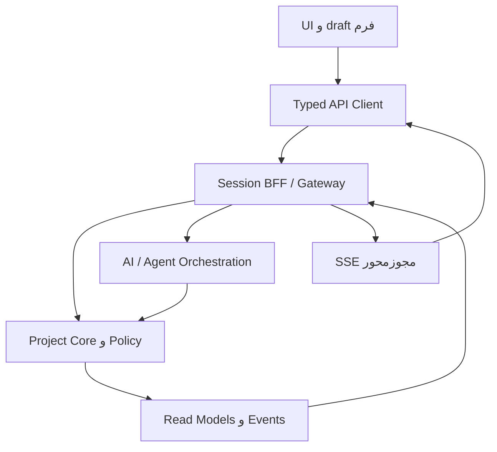

# EmpireProject — سند مستقل ساخت UI و قرارداد اتصال به موتور پروژه

**نسخه:** 1.0  
**تاریخ:** ۲۷ اکتبر ۲۰۲۶  
**مخاطب:** طراح محصول، توسعه‌دهندهٔ Frontend، Backend/Go، AI، QA و Codex  
**مبنای دامنه:** `EmpireProject_Production_Spec_FA_v2.5.md` و `EmpireProject_Adversarial_Test_Plan_FA_v1.4.md`  
**وضعیت:** قرارداد پیشنهادی برای پیاده‌سازی؛ APIهای موجود، احراز هویت و استقرار با سورس موتور تطبیق داده نشده‌اند. هیچ آزمون اتصال یا UI در تدوین این فایل اجرا نشده است.

## 0. این فایل چه چیزی را تحویل می‌دهد؟

یک مرجع واحد برای ساخت رابط وب EmpireProject و اتصال آن به موتور: معماری اطلاعات، صفحات، نقش‌ها، فرم‌ها، تعامل AI/صوت، مدل دادهٔ نمایشی، REST، SSE، خطا، مجوز، نسخه، concurrency، فایل، آزمون و اطلاعات موردنیاز از تیم. طراح و برنامه‌نویس نباید برای فهم هر مسیر از ابتدا به چت برگردند. این فایل یک OpenAPI کاملِ machine-readable یا کد آمادهٔ اجرا نیست؛ پس از تطبیق با موتور، قراردادهای اینجا باید به OpenAPI و event schema نسخه‌دار تبدیل شوند.

### 0.1 قواعد حاکم

1. Core مالک state، مجوز، نسخه، تاریخچه و رسید است؛ UI و LLM مالک حقیقت پروژه نیستند.
2. پرسش، draft، پیشنهاد، commit، اجرای Agent، پذیرش انسانی و انتشار هفت مفهوم جدا هستند.
3. هر جا داده ناقص است پرسش یا `unknown` نشان بده؛ مقدار واقعی از حدس UI/AI ساخته نشود.
4. هر نما باید بدون AI نیز قابل استفاده باشد. AI در context کار حضور دارد و می‌تواند نمای اصلی را تغییر دهد.
5. تمام مسیرهای نوشتن، حتی drag/drop، voice و AI، از command معتبر با مجوز و concurrency عبور کنند.
6. نمونه‌های داده این فایل مصنوعی‌اند؛ محیط Demo همیشه نشان مشخص دارد. در حالت Live هیچ fallback به دادهٔ ساختگی وجود ندارد.
7. اصول دامنهٔ Spec 2.5 پابرجاست. قرارداد transport جدید این فایل یک پیشنهاد توسعه است؛ ناسازگاری با API موجود باید در adapter/ADR حل شود، نه با تغییر بی‌صدای معنا.

### 0.2 تصمیم‌های اجرایی اولیه

| موضوع | تصمیم پیشنهادی | قطعیت |
|---|---|---|
| محصول | وب دسکتاپ با پشتیبانی تبلت و موبایل؛ فارسی/RTL و انگلیسی/LTR | مبنای طراحی |
| زبان پیاده‌سازی UI | TypeScript و React؛ اگر مخزن موجود stack دیگری دارد ابتدا تطبیق | پیشنهاد، نسخه بعد از بررسی repo pin شود |
| ارتباط مرورگر | same-origin BFF/Gateway؛ REST JSON برای command/query و SSE برای update | قرارداد این سند |
| ارتباط داخلی | Go services پشت Gateway؛ gRPC/broker در داخل، نه در مرورگر | مطابق Spec |
| تعریف API | OpenAPI خانوادهٔ 3.1 و JSON Schema؛ نسخهٔ دقیق سازگار با ابزارها pin | پیشنهاد؛ ادعای «آخرین نسخه» ندارد |
| state سمت UI | server cache مجزا از local draft و URL state | الزام معماری |
| طراحی | سطح‌های خوانا، شیشه‌ای محدود، رنگ کنترل‌شده، تمرکز بر کار و تصمیم | تا دریافت نمونهٔ تصویری، فرض طراحی |
| هویت | web session امن در BFF؛ provider حقیقی نامشخص | اتصال Live مسدود تا اطلاعات بخش 18 |

## 1. تجربهٔ اصلی و معیار موفقیت

کاربر باید بتواند بگوید: «کارهای با اولویت بالا را در تقویم این هفته نشان بده»، «این فایل را به Backlog تبدیل کن»، «برای این هدف برنامه بساز و به ایجنت‌ها بده». نتیجه باید در همان صفحه به فیلتر، فرم، پیشنهاد یا خروجی واقعی تبدیل شود. پیام متنی صرف، موفقیت این مسیر نیست.

سه کنش پرتکرار باید با حداکثر سه اقدام رابط از context پروژه قابل دسترسی باشند: بازکردن Issue، ثبت تغییر ساده و رسیدن به پیشنهاد AI. فرم طولانی، انتخاب اجباری و تأیید امنیتی از این معیار حذف نمی‌شوند؛ برای رسیدن به عدد سه نباید کنترل لازم حذف شود.

| نقش | صفحهٔ آغاز | تصمیم مهم | شواهد ضروری |
|---|---|---|---|
| Owner / PM | Overview + Attention | الان کدام تصمیم/کار باید جلو برود؟ | Goal، blocker، deadline، budget، next action |
| Scrum Master | Active Sprint / Board | چه مانعی جریان را بسته است؟ | WIP، aging، capacity، scope change، نیاز به تصمیم |
| Developer | My Work | چه کار آماده‌ای دارم؟ | priority، وابستگی، criteria، branch/artifact، review |
| Reviewer / Lead | Review Inbox | آیا خروجی قابل قبول است؟ | نسخه، diff، تست، DoD و evidence |
| Admin | People & Settings | چه کسی به چه چیزی دسترسی دارد؟ | role/grant، revision، audit و readiness |
| Viewer | نمای مجاز پروژه | وضعیت واقعی چیست؟ | دادهٔ read-only با as-of و منبع |

نام نقش مجوز نیست. `capabilities` و `allowed_actions` دریافتی از موتور، affordance رابط را تعیین می‌کنند و سرور هر فرمان را دوباره بررسی می‌کند.

## 2. معماری اطلاعات و مسیر صفحات

`/o/:orgId/p/:projectId` ریشهٔ پروژه در URL رابط است؛ این URL با API یکی نیست. project switcher در سربرگ ثابت، جست‌وجو، پروژه‌های اخیر/ستاره‌دار و وضعیت archive دارد؛ context پروژه و سازمان همیشه قابل تشخیص است.

| مسیر UI زیر ریشه | صفحه و اجزای اصلی | کنش اصلی |
|---|---|---|
| `/overview` | Goal، سلامت جریان، تصمیم‌های منتظر، Sprint/Release، budget و activity | دیدن علت و اقدام بعدی |
| `/work?view=list\|board\|calendar\|timeline` | query/filter مشترک، چهار نما، selection و drawer مشترک | یافتن، ساخت و تغییر کار |
| `/backlog` | درخت Epic/Issue، رتبه، Sprintهای planned، ظرفیت و deferred | آماده‌سازی و تخصیص به Sprint |
| `/sprints/:id` | Goal، commitment، scope change، DoD، گزارش | start/complete با preview |
| `/intake` و `/intake/:id` | کادر ایده/لینک/فایل/صوت؛ triage و پرسش | ساخت ExecutionPlan |
| `/datacarts/:id` | فایل، scan/parse، mapping، خطا، draft graph، preview و receipt | ورود دادهٔ تأییدشده |
| `/plans/:id` | DAG کارها، roles، dependencies، cost، diff، approval | اصلاح و تأیید برنامه |
| `/agents` و `/runs/:id` | عضویت Agent، capability/readiness؛ تلاش، progress، blocker و artifact | واگذاری، توقف/ادامهٔ مجاز |
| `/reviews/:id` | معیارها، artifact diff، test evidence و verdict | درخواست اصلاح یا پذیرش مجاز |
| `/gallery` | خروجی‌ها، وضعیت، version، preview و lineage | مشاهده و تحویل |
| `/knowledge` | اسناد/تصمیم‌ها، source versions، freshness، جست‌وجو و citations | بازیابی دانش مجاز |
| `/reports` | query طبیعی، metric definition، جدول/نمودار، snapshot | گزارش مستند و export |
| `/releases` | scope، وابستگی، gate، artifact و environment | تصمیم release |
| `/people` | Human/Agent/Group و نقش پروژه | مدیریت عضویت |
| `/settings` | workflow، types، priority، custom fields، calendar، connections و policies | پیکربندی نسخه‌دار |
| `/activity` | تاریخچه با actor، before/after و receipt | بررسی تغییر |

مسیرهای سازمانی مستقل: `/o/:orgId/projects`، `/inbox`، `/my-work`، `/search`، `/program-releases`، `/admin`. پیش‌فرض sidebar فقط Project، Work، Backlog، Inbox، Agents، Knowledge و More را نشان دهد؛ گروه‌های بیشتر با نقش/نیاز ظاهر شوند. تمام قابلیت‌های غیرقابل عرضه با feature capability مشخص شوند، نه دکمهٔ بی‌عمل.

Deep link باید به Work Item با canonical ID برسد؛ کلید نمایشی و alias قابلیت resolve دارند. Drawer روی همان route state باز شود تا refresh، share و back/forward قابل پیش‌بینی باشند. پس از تغییر سازمان، cache، stream، selection و draft حساس سازمان قبلی پاک یا در scope امن بسته شوند.

## 3. طراحی بصری و تعامل

### 3.1 اسکلت صفحه

- سربرگ ۵۶px پیشنهادی: project switcher، breadcrumb، search/command، create، inbox و profile.
- sidebar حدود ۲۲۴px و حالت فشردهٔ ۶۴px؛ در RTL لبهٔ شروع راست است.
- toolbar کاری: عنوان و شمار، view switch، filter chips، sort/group، range و کنش اصلی.
- فضای اصلی حداقل ۷۰٪ عرض صفحه را هنگام بسته‌بودن پنل AI بگیرد؛ drawer حدود ۴۸۰–۶۴۰px و در موبایل تمام‌صفحه است.
- پنل AI contextual و قابل بستن باشد؛ کاربر با بازکردنش context اصلی را از دست ندهد. پیشنهاد AI بتواند در فضای اصلی به جدول/برنامه/کارت تصمیم تبدیل شود.
- صفحهٔ آغاز نباید با کارت‌های آماری تکراری اشغال شود؛ تصمیم، کار مانده و blocker قابل اقدام مقدم‌اند.

### 3.2 توکن‌های پیشنهادی تا دریافت هویت بصری

| توکن | مقدار مبنا | کاربرد |
|---|---|---|
| background | `#F5F7FA` | زمینهٔ روشن |
| surface | `#FFFFFF` | داده، فرم و جدول خوانا |
| text | `#172033` | متن اصلی |
| muted | `#536176` | متن ثانویه؛ contrast آزموده شود |
| accent | `#176B66` | کنش اصلی و selection |
| border | `#DCE3EC` | جداسازی آرام |
| danger / warning / success | token معنایی مجزا | همراه متن و آیکون؛ صرف رنگ کافی نیست |
| spacing | 4، 8، 12، 16، 24، 32px | ریتم ثابت |
| radius | 8 برای input، 12 برای panel، 16 برای overlay | محدود و یکدست |
| font | فونت فارسی خوانا با مجوز مناسب + system Latin | فایل/مجوز از تیم دریافت شود |

Glass فقط در header، overlay و لایه‌های کم‌تراکم؛ جدول، متن طولانی و فرم روی سطح واضح. Dark theme از tokenهای مستقل و contrast معتبر ساخته شود؛ معکوس‌کردن سادهٔ رنگ کافی نیست. motion کوتاه ۱۲۰–۱۸۰ms پیشنهاد است؛ reduced-motion رعایت شود. این اعداد معیار شروع‌اند، نه نتیجهٔ UAT.

### 3.3 قواعد دسترس‌پذیری و پاسخ‌گویی

هر drag/drop معادل keyboard/form دارد. focus پس از modal و update حفظ شود. label و error به input متصل، live announcement برای نتیجهٔ عملیات و heading hierarchy درست باشد. روی موبایل Board اسکرول افقی کنترل‌شده، drawer تمام‌صفحه و Timeline حالت list جایگزین دارد. کنترل‌های لمس حداقل ۴۴px هدف طراحی باشند. فارسی/انگلیسی، اعداد، URL و شناسه با direction مستقل نمایش داده شوند؛ تاریخ ذخیره‌شده از تقویم نمایشی جداست.

## 4. فرم‌ها و صفحهٔ Work Item

### 4.1 ساخت پروژه

نام، key پیشنهادی و یکتا، Owner انسانی، روش Scrum/Kanban، template، timezone و working calendar حداقل setup هستند. ابتدا Project با Owner commit شود؛ سپس عضویت‌ها، Agentها، connections و grantها تنظیم شوند. template، credential و مجوز را کپی نمی‌کند. ساخت با prompt/voice فقط draft همین فرم است.

### 4.2 Work Item drawer و صفحهٔ کامل

سربرگ: key، type، summary، status، priority، assignee، More. بدنه: description، acceptance criteria، parent/children، dependencies، dates، estimate، Sprint/Release، custom fields. tabs: Activity، Comments، Files، Agent Runs، Reviews و Links. در Activity امکان دیدن actor/time/before-after و نسخه باشد؛ حذف عادی به archive/tombstone تبدیل شود.

| فیلد | منبع | validation و رفتار |
|---|---|---|
| type / status / priority | project schema | IDها از سرور؛ label hardcode نشود |
| assignee | memberships مجاز | Human/Agent و readiness؛ نام بدون ID معتبر نیست |
| parent / dependency | search مجاز | نوع/سطح hierarchy، cycle و ACL در سرور |
| summary / description | انسان یا draft AI | required/max length از schema؛ render sanitized |
| start / due | date contract | date-only یا instant مشخص؛ start بعد due رد |
| estimate / points | field schema و unit | تخمین AI پیشنهادی؛ اندازهٔ تأییدشده جدا |
| labels / components | schema و مجوز | create label در صورت capability |
| custom_data | تعریف فیلد نسخه‌دار | typed form؛ JSON پیشرفته فقط برای کاربر مجاز |

`Issue` نام عمومی Work Item است؛ تبدیل هر ورودی به Epic/Bug بدون شاهد ممنوع. Bug نیازمند شرح نقص واقعی، انتظار/واقعیت و شاهد است. custom_data همهٔ موجودیت‌های entry جدید را پوشش می‌دهد، اما scope/permission/workflow را بازنویسی نمی‌کند. تعریف فیلد شامل key، type، required، visibility، editable، enum، constraints و schema_revision است. وضعیت field unknown/migrated نباید با پاک‌کردن مقدار حل شود.

## 5. چهار نمای همگام و Sprint

| نما | رفتار ضروری | حالت‌های مرزی |
|---|---|---|
| List | ستون configurable، sort/group، cursor، quick edit و bulk preview | sort با rank و priority یکی نیست؛ selection بین صفحه‌ها صریح |
| Board | ستون workflow، swimlane، WIP، aging و blocker، drawer | status بی‌ستون سینی مستقل؛ transition required fields قبل commit |
| Calendar | روز/هفته/ماه؛ due/start/start-and-due، موعد و دیرکرد | unscheduled/outside-window شمار دارند؛ due-only بازهٔ جعلی ندارد |
| Timeline | bar برای start+due، marker برای یک تاریخ، dependency مجاز | blocker مخفی بدون نام/زمان؛ start>due و cycle هشدار/رد |

تمام نماها `workset_ref`، query revision، scope، filters و selection مشترک دارند. پنجرهٔ تقویم، شرط query نیست مگر کاربر آن را فیلتر کند. شمارها از موتور بیایند؛ UI از آیتم‌های صفحهٔ جاری total نسازد. List: workset=rendered؛ Board: workset=rendered+unmapped؛ Calendar/Timeline: workset=rendered+unscheduled+outside_window. page_count جداست.

Drag کارت: preview انتقال → دریافت فرم/validator transition → ارسال command → نمایش pending → receipt موفق یا بازگردانی با خطای واضح. جابه‌جایی تاریخ همین مسیر را دارد. bulk selection باید `selected_ids` یا snapshot selection token محدود به query داشته باشد؛ «همه» به معنی همهٔ دادهٔ tenant نیست.

Backlog/Sprint: parent و subtask دوبار در ظرفیت جمع نشوند؛ AI برش هدف‌محور، deferred reasons و fit_unknown/does_not_fit/fits بدهد. Sprint planned با active متفاوت است. start، complete، reopen و scope change actionهای رسمی با permission و preview هستند. گزارش Sprint تعریف metric و baseline را نشان دهد.

## 6. AI، صوت و پیشنهاد قابل اعتماد

### 6.1 ورودی مشترک

Composer در context صفحه: متن، فایل، link، mention منبع مجاز و میکروفون. scope فعلی، selection و نوع کار (پرسش/پیشنهاد/استخراج) آشکار باشند. microphone فقط با کنش کاربر فعال، indicator و stop داشته باشد؛ حالت دائماً شنونده پیش‌فرض نیست.

صوت: capture → upload مجاز → transcription job → متن قابل ویرایش → استخراج draft فیلدها → نمایش مقدار/منبع/confidence → رفع ابهام → تأیید کاربر → command معمول. املا/نام مشابه، «سه‌شنبه» بدون timezone یا assignee نامشخص باید پرسیده شود. transcription به‌خودی‌خود submit فرم نیست. خام صوت retention/consent policy دارد و default ذخیرهٔ دائمی نیست. در نبود speech provider، قابلیت صوت unavailable اعلام شود و ورودی متنی فعال بماند.

### 6.2 خروجی‌های typed

خروجی wire این قرارداد از انواع نسخهٔ جدید Spec استفاده می‌کند: `answer`, `clarifying_question`, `insight_case`, `action_proposal`, `execution_progress`, `outcome_review`. `question` قدیمی به `clarifying_question` و `proposed_action` به `action_proposal` فقط در adapter نسخه‌دار نگاشت شود. نوع ناشناخته به renderer امن «قابلیت این نسخه پشتیبانی نمی‌شود» می‌رود.

هر پاسخ ساختاریافته می‌تواند `view_transition` محدود به allowlist، citation، query_run، questions یا proposal refs داشته باشد. UI کد، HTML، SQL یا expression دلخواه مدل را اجرا نمی‌کند. پاسخ متنی sanitize شود. «تغییر اعمال شد» فقط از receipt معتبر ساخته شود.

### 6.3 کارت پیشنهاد

نمایش: چه تغییر می‌کند، چرا، شواهد، before/after، هزینه/اثر، scope، expiry، required permissions و missing fields. CTA: Apply/Approve، Edit، Reject، Ask why. Edit revision جدید می‌سازد و approval قبلی را معتبر نگه نمی‌دارد. batch proposal با نتیجهٔ per-item و policy atomicity نمایش داده شود.

### 6.4 گزارش با زبان طبیعی

QueryPlan برای عدد/فیلتر/aggregation، RAG برای متن و توضیح. پاسخ باید منبع عدد، as-of، completeness، definition و citation داشته باشد. «چرا عقب افتادیم» مشاهده، تفسیر و فرضیه را جدا نمایش دهد. query فاقد دادهٔ کافی به insufficient_evidence تبدیل شود. نمایش trace فنی/توکن در جریان عادی لازم نیست؛ پنل diagnostics برای نقش مجاز کافی است.

## 7. DataCart، Agent، Gallery و Memory

### 7.1 DataCart

Stepper پایدار: Uploaded → Scanning → Parsing → Mapping → Needs input → Validated → Preview → Approved → Committing → Completed/Partial/Failed. state واقعی از سرور؛ scan pending فایل را وارد RAG نکند. grid ردیف‌ها با source locator، proposed type/priority/labels، confidence، duplicate و field errors. کاربر mapping را اصلاح، سؤال را پاسخ و فقط ردیف معتبر مستقل را import کند. قطع مرورگر job را حذف نکند؛ بازگشت از URL ادامهٔ واقعی را نشان دهد.

### 7.2 مسیر از ایده تا تحویل

Intake → Plan → Human Gate → Execute → Review → Accepted → Shipped & Filed. برنامه شامل DAG، نقش‌ها، scope، بودجه، tests و DoD است. برد Triage/Todo/Ready/Running/Blocked/Done projection کار واقعی باشد؛ waiting for review نشان مستقل دارد. ACK، submitted، accepted و shipped یکی نیستند.

Task drawer: owner/Agent، connection readiness، brief، dependencies، comments، events، attempt/checkpoint، cost، artifacts و review. producer حق پذیرش خروجی خودش ندارد. تغییر مؤثر برنامه، مجوز یا بودجه نیازمند revalidation/reapproval است. Stop/Resume این صفحه کنترل Run مشخص است و نباید با readiness اتصال اشتباه شود.

### 7.3 Gallery و Memory

Gallery کارت خروجی با type/project/status/version/reviewer/preview/lineage دارد؛ draft و accepted و shipped برچسب متفاوت دارند. preview زنده فقط deployment معتبر و مجاز؛ فایل HTML غیرقابل اعتماد روی origin اصلی اجرا نشود، از sandbox origin با policy محدود استفاده شود. Memory: search/list اسناد و تصمیم‌ها در P0؛ graph/Memory Galaxy و Obsidian integration در P1. متن source، version، freshness و ACL در هر مسیر رعایت شود؛ graph مشتق است و جای DB حقیقت را نمی‌گیرد.

## 8. معماری Frontend و مرز اتصال



مرورگر مستقیم به Kubernetes، DB، broker، vector store، service worker API یا provider مدل متصل نمی‌شود. BFF تجمیع/احراز هویت و ترجمهٔ transport را انجام می‌دهد، نه محاسبهٔ مجوز یا قوانین Sprint. file bytes فقط با upload ticket کوتاه‌عمر به storage مجاز می‌روند.

ساختار پیشنهادی سورس: `app/` routes؛ `features/{work,views,datacart,ai,agents,reviews,...}`؛ `domain/` types؛ `api/generated/` و adapter؛ `components/` primitives؛ `design-tokens/`؛ `i18n/`؛ `test/fixtures/` و contract mocks. دریافت داده در component پراکنده نشود؛ API client مشترک مسئول header، errors، cancellation و request correlation باشد.

Server cache با کلید org/project/resource/filter/permission revision، URL state برای scope/view/filter/window و local state برای draft/selection/overlay جدا باشند. تعویض project درخواست‌های درحال‌اجرا را cancel یا نتیجهٔ خارج scope را ignore کند. secret/token در localStorage، URL، analytics یا console ذخیره نشود. persist محلی دادهٔ خصوصی در P0 خاموش؛ offline write queue تا قرارداد reconcile مستقل فعال نشود.

## 9. پروتکل HTTP، session و قرارداد عمومی

### 9.1 URL و احراز هویت

Browser API base: `/api/ep/v1` روی origin UI. Gateway نگاشت یک‌به‌یک به Engine `/v1` دارد. در ادامه `O = /orgs/{org_id}` و `P = /orgs/{org_id}/projects/{project_id}` هستند؛ همهٔ pathها به base اضافه می‌شوند. مسیر BFF session (`/api/session`) مستقل است. محیط/host واقعی در بخش 18 تعیین می‌شود.

BFF session: cookie با HttpOnly، Secure، SameSite مناسب topology؛ درخواست نوشتن با CSRF token و Origin validation. session credential و bearer token سرویس در JavaScript افشا نشوند. OIDC/روش login واقعی از تیم دریافت شود؛ بخش BFF تا آن زمان mock قابل تشخیص دارد. اگر BFF موجود نیست، تغییر به SPA bearer یک ADR جدا با token lifecycle، PKCE، CORS و SSE client مناسب می‌خواهد؛ انتخاب خودکار ممنوع.

`GET /api/session` حداقل user_id، memberships/orgs مجاز، locale/timezone، csrf_token و expiry را برگرداند. logout cookie را revoke، stream و cache را پاک کند. 401 بدون loop به login؛ 403 به توضیح مجوز و پاکسازی resource مربوط، نه retry بی‌نهایت.

### 9.2 headers و concurrency

| مورد | قرارداد |
|---|---|
| Content-Type | `application/json`؛ خطا `application/problem+json` |
| X-Request-ID | client UUID اختیاری؛ server request_id معتبر برمی‌گرداند |
| Idempotency-Key | UUID برای هر intent نوشتن؛ retry همان intent همان key |
| If-Match | strong ETag دریافتی برای update/transition/approval؛ مقدار opaque حفظ شود |
| X-CSRF-Token | برای mutation تحت session؛ صادرشده از BFF |
| Accept-Language | ترجیح نمایش؛ code/ID/enum مستقل از زبان |
| Retry-After | server در 429/503؛ client به آن و budget زمانی احترام بگذارد |

Idempotency scope: principal + org + operation route + key؛ body hash متفاوت با همان key → 409 IDEMPOTENCY_CONFLICT. همان درخواست اثر و receipt یکسان برگرداند. نگهداری اولیهٔ key حداقل ۲۴ ساعت پیشنهادی و server-advertised؛ پس از انقضا ابتدا reconcile، سپس فقط با تصمیم صریح intent تازه. Business uniqueness مثل source-row binding مستقل از عمر key است. برای POST query read-only، key لازم نیست.

Precondition ناقص → 428؛ ETag کهنه → 412؛ تضاد دامنه (WIP، cycle، expired proposal) → 409؛ خطای field → 422؛ 413 فایل بزرگ، 415 نوع نامعتبر، 429 quota. 404 می‌تواند برای عدم افشای وجود resource استفاده شود. UI متن debug یا stack سرور را نمایش ندهد.

### 9.3 envelope خواندن

```json
{
  "data": [{"id":"wi_01","key":"EMP-104","version":17,"summary":"عضویت باشگاه","status_id":"st_todo","custom_data":{}}],
  "meta": {
    "request_id":"req_01","as_of":"2026-10-27T12:00:00Z",
    "next_cursor":null,"snapshot_id":"snap_01",
    "permission_revision":"perm_8","freshness":"current",
    "watermark":"evt_450","count":{"value":1,"relation":"exact"}
  }
}
```

Single resource: data object و ETag در header. List: default limit=50 و max=200 پیشنهادی و اعلام‌شده در capabilities؛ cursor opaque، وابسته به sort/query/snapshot و ACL. sort پایدار با ID tie-break. count unknown/estimated باید برچسب داشته باشد؛ total از page_count ساخته نشود. cursor منقضی → 409 CURSOR_EXPIRED و refresh صفحهٔ اول با حفظ query. snapshot مجوز قدیمی را زنده نگه نمی‌دارد؛ revoke حتی snapshot ثابت را محدود/باطل می‌کند.

### 9.4 مدل مشترک resource و زمان

Resource: id canonical، org_id، project_id در صورت پروژه‌ای، resource_type، resource_ref، version integer، created_at/updated_at، provenance، custom_data و allowed_actions. nullable بودن فیلد در schema صریح باشد؛ omitted یعنی ارسال‌نشده/انتخاب‌نشده، null یعنی خالی در قرارداد همان فیلد. ID همیشه string opaque؛ version عدد صحیح مثبت. پول decimal string همراه currency، duration واحد صریح، progress همراه مبنا؛ points با ساعت یکی نیست.

DateValue یک union: `{kind:"date",value:"2026-11-03"}` یا `{kind:"instant",value:"2026-11-03T09:00:00Z"}`؛ timezone نمایش IANA از پروژه/کاربر، با precedence مشخص پروژه برای deadline. date-only با midnight UTC تبدیل نشود. فیلدهای legacy start_at/due_at در adapter به این مدل نگاشت مستند دارند؛ اگر موتور date-only ندارد، باید پشتیبانی شود یا UI آن ورودی را غیرقابل پشتیبانی اعلام کند، نه حدس بزند.

### 9.5 نمونهٔ command انتقال

```http
POST /api/ep/v1/orgs/org_01/projects/prj_01/work-items/wi_01/transitions
Content-Type: application/json
If-Match: "wi_01:17"
Idempotency-Key: 9e7f56d6-251a-4c21-86a9-e91fd2fc4413
X-CSRF-Token: <session-issued-token>

{"transition_id":"tr_start","fields":{},"reason":"آغاز کار مصوب"}
```

```json
{
  "data": {
    "resource":{"id":"wi_01","version":18,"status_id":"st_progress"},
    "receipt":{"id":"rcpt_01","command_id":"cmd_01","outcome":"applied","resource_version":18,"audit_ref":"audit_01"}
  },
  "meta":{"request_id":"req_02","as_of":"2026-10-27T12:01:00Z","permission_revision":"perm_8"}
}
```

پاسخ 200 و ETag تازه دارد. Resource خلاصه است؛ فیلدهای دیگر از cache معتبر حفظ یا GET شوند. status مستقیماً PATCH نشود. PATCH فقط JSON Merge Patch با `application/merge-patch+json` برای فیلدهای allowlist، null مطابق schema حذف/خالی می‌کند و array کامل جایگزین می‌شود؛ custom_data باید با If-Match و schema validation merge شود. تغییر permission، type conversion، move و workflow action مسیر اختصاصی دارند.

### 9.6 async و نتیجهٔ نامعلوم

```json
{
  "data":{"operation_id":"op_01","state":"queued","status_url":"/api/ep/v1/orgs/org_01/operations/op_01"},
  "meta":{"request_id":"req_03","as_of":"2026-10-27T12:02:00Z"}
}
```

پاسخ 202 همراه Location است؛ queued/running/waiting_input/succeeded/partial/failed/cancelled وضعیت‌های Operation هستند. status result شامل receipts، failed_items و result_ref می‌شود. 202 موفقیت اثر تجاری نیست. timeout شبکه → `outcome_unknown` در client؛ همان key یا operation lookup reconcile شود. cancel یک درخواست است؛ `cancel_requested` تا ACK با cancelled یکی نیست. polling با backoff و jitter و توقف هنگام terminal، سقف پیشنهادی ۳۰ ثانیه؛ SSE اولویت دارد.

### 9.7 Problem Details

```json
{
  "type":"urn:empireproject:problem:version-conflict",
  "title":"نسخهٔ کار تغییر کرده است","status":412,
  "code":"VERSION_CONFLICT","detail":"پیش از ذخیره نسخهٔ تازه را بررسی کنید.",
  "instance":"req_04","trace_id":"trace_01","retryable":false,
  "current_version":19,
  "field_errors":[{"path":"/due","code":"REVALIDATE","message":"موعد را دوباره بررسی کنید."}]
}
```

Conflict UI: draft کاربر را نگه دار؛ latest مجاز را بخوان؛ before/latest/yours و انتخاب merge نشان بده؛ بدون تأیید overwrite نکن. 429/503 برای read retry کنترل‌شده، برای write فقط با key ثابت و reconcile. آفلاین: banner، توقف mutation، draft محلی فقط در حافظه؛ اتصال برگشت revalidate شود.

## 10. کاتالوگ API برای ساخت UI

**همهٔ مسیرهای این بخش قرارداد پیشنهادی‌اند.** مسیرهای هم‌معنی Spec 27 حفظ شده و مسیرهای جزئی جدید باید با OpenAPI واقعی تطبیق یابند. `R` یعنی read، `W` یعنی write با permission/receipt، `A` یعنی write async. هر W/A علاوه بر زیر، قواعد بخش 9 را رعایت کند.

| حوزه | endpoint زیر base | ورودی / خروجی اصلی |
|---|---|---|
| bootstrap | `GET O/capabilities`، `GET P/snapshot` | feature flags، limits، schema revisions؛ summary، readiness، gates و as-of |
| پروژه | `GET/POST O/projects`، `GET/PATCH P` | filter/cursor؛ ProjectDraft → Project/receipt |
| schema | `GET P/schemas` | types، fields، priorities، statuses، transitions و calendars |
| عضویت | `GET/POST P/memberships`، `PATCH P/memberships/{id}` | principal/role؛ state/grant revisions |
| lookup | `GET O/principals?search=...`، `GET P/memberships?search=...` | فقط identity مجاز؛ pagination |
| گروه/نقش | `GET O/groups`، `GET/POST P/role-bindings` | group/principal و role؛ effective membership lineage |
| کار | `GET/POST P/work-items`، `GET/PATCH P/work-items/{id}` | typed fields و version/ETag |
| transition | `GET P/work-items/{id}/transitions`، `POST .../transitions` | actions مجاز + form schema؛ transition_id/fields → receipt |
| زیربخش کار | `GET/POST P/work-items/{id}/{comments\|links\|worklogs}` | typed body/version و source refs |
| تاریخچه | `GET P/work-items/{id}/activity` | cursor و audit refs بدون secret |
| تغییرات حساس | `POST P/work-items/{id}/{move-previews\|moves\|clones\|archives\|restores}` | preview/mapping/version؛ restore grant قدیمی را احیا نکند |
| bulk | `POST P/work-items/bulk-previews`، `POST P/work-items/bulk-operations` | ids/selection_token، action، per-item expected versions؛ atomicity و per-item receipts |
| search | `POST O/work-items/search` | typed QueryPlan یا saved_filter_ref؛ read-only، cursor/columns |
| نما | `GET/POST P/views`، `PATCH P/views/{id}`، `POST P/views/{id}/query` | ViewSpec/QueryPlan refs؛ workset counts، items و window |
| Board | `GET/POST P/boards`، `GET P/boards/{id}/items`، `POST P/boards/{id}/rank` | mapping/WIP؛ before/after anchors با rank revision |
| Sprint | `GET/POST P/boards/{id}/sprints`، `GET/PATCH P/sprints/{id}` | goal/calendar/state؛ lifecycle version |
| Sprint actions | `POST P/sprints/{id}/{previews\|starts\|completions\|reopens\|scope-changes}` | action-specific schema؛ validators/baseline/receipt |
| ظرفیت | `POST P/sprint-fit/simulations` | graph/capacity snapshot refs؛ fits/does_not_fit/fit_unknown |
| فایل | `POST P/uploads`، `POST P/uploads/{id}/completions`، `GET P/uploads/{id}` | upload ticket، checksum و scan state |
| DataCart | `POST/GET P/datacarts`، `GET P/datacarts/{id}` | source upload/ref؛ state/coverage/counts |
| DataCart steps | `POST P/datacarts/{id}/{analyses\|validations\|previews\|approvals\|commits}` | mapping/source revisions؛ job/receipt |
| mapping/rows | `PATCH P/datacarts/{id}/mapping`، `GET/PATCH P/datacarts/{id}/rows/{row_id}` | field errors و source locator؛ If-Match |
| draft graph | `POST P/datacarts/{id}/decompose`، `GET/PATCH .../backlog-draft` | hierarchy/type/priority/uncertainty؛ source-bound IDs |
| AI | `POST P/ai/interactions`، `GET P/ai/interactions/{id}`، `POST .../answers` | prompt/context refs؛ typed output/question continuation |
| proposal | `GET/PATCH P/proposals/{id}`، `POST .../{approvals\|commits\|rejections}` | version/hash/expiry؛ preview و command receipt |
| speech | `POST P/transcriptions`، `GET P/transcriptions/{id}` | ready upload/locale؛ transcript/segments/uncertainty/retention |
| intake | `GET/POST P/intakes`، `GET P/intakes/{id}`، `POST .../plans` | source/objective؛ ProjectCase و ExecutionPlan refs |
| plan | `GET/PATCH P/plans/{id}`، `POST .../{simulations\|approvals\|executions}` | DAG/version/scope/budget؛ validation/approval/operation |
| Agent | `GET P/agents`، `POST P/memberships/{id}/checks` | model/runtime/tool/retrieval probes و readiness |
| assignment | `POST P/work-items/{id}/assignments` | membership + approved_plan_ref؛ Run/TaskEnvelope refs |
| Run | `GET P/runs`، `GET P/runs/{id}`، `POST .../{pauses\|cancellations\|resume}` | attempt/state/checkpoint/interrupt response؛ cost و receipt |
| review | `GET P/reviews`، `POST P/work-items/{id}/reviews`، `POST P/reviews/{id}/decisions` | artifact version، criteria/evidence؛ verdict/acceptance policy |
| artifact | `GET P/artifacts`، `GET P/artifacts/{id}`، `POST .../access-tickets` | metadata/hash/classification؛ scoped short-lived access |
| Gallery | `GET P/gallery` | accepted/draft/shipped status، delivery receipt، preview metadata |
| دانش | `GET/POST P/knowledge/sources`، `GET .../{id}/versions`، `POST P/knowledge/search` | source/version/ACL/freshness/citation |
| resolve | `POST O/resources/resolve` | refs؛ per-item resolved/denied بدون metadata محرمانه |
| گزارش | `POST P/reports/{type}/runs`، `GET .../runs/{id}` | metric definition/query/context؛ result/completeness/citation |
| export | `POST P/exports`، `GET P/exports/{id}` | frozen query + ACL current؛ artifact ticket و expiry |
| Release | `GET/POST P/releases`، `GET/PATCH P/releases/{id}`، `POST .../{previews\|approvals\|deliveries}` | scope/gates/environment؛ تحویل async با receipt |
| Inbox | `GET O/inbox`، `POST O/inbox/{id}/{reads\|snoozes\|responses}` | context/resource refs؛ dedup/revision |
| settings | `GET/POST P/workflows`، `POST .../{id}/{validations\|publications}` | versioned graph + migration map؛ approval/receipt |
| connections | `GET/POST P/connections`، `POST .../{id}/checks` | credential_ref/health/capabilities؛ secret هرگز echo نشود |
| audit/operations | `GET P/activity`، `GET O/operations/{id}`، `GET O/commands/by-key?key=...` | scoped receipts و operation reconciliation |
| event stream | `GET P/events` | SSE مجوزمحور با cursor و replay |

نام endpoint یا HTTP method به تنهایی مجوز نیست. GET نباید اثر تجاری داشته باشد. routeهایی که چند action در یک ردیف دارند باید در OpenAPI به operationId مستقل تبدیل شوند. org-wide Inbox به stream scoped سازمانی اختیاری نیاز دارد؛ در P0 polling کنترل‌شده کافی است. refresh کامل همهٔ پروژه‌ها به ازای هر event ممنوع.

## 11. نمونهٔ قراردادهای کلیدی UI

### 11.1 AI request و view transition

```json
{
  "prompt":"کارهای اولویت بالا را روی تقویم این هفته نشان بده",
  "context":{"project_id":"prj_01","view_id":"view_01","selection_ids":[],"locale":"fa-IR","timezone":"Asia/Tehran"},
  "input_refs":[],"mode":"query","custom_data":{}
}
```

```json
{
  "kind":"answer","interaction_id":"ai_01","version":1,
  "text":"کارهای اولویت بالا؛ پنجرهٔ نمایش این هفته است.",
  "view_transition":{"kind":"calendar","query_plan_id":"qp_01","query_plan_revision":1,"date_field":"due","window":{"start_date":"2026-10-24","end_date_exclusive":"2026-10-31"}},
  "query_run_ref":"qr_01","citations":[],"proposal_refs":[],
  "freshness":"current","as_of":"2026-10-27T12:00:00Z"
}
```

این body، `data` پاسخ endpoint است. context انتخاب کاربر است؛ identity/grant/budget از سرور resolve می‌شود. پنجرهٔ مثال مصنوعی است؛ «این هفته» براساس working calendar مصوب محاسبه شود. مدل ID فیلتر/permission را از خود نمی‌سازد؛ Engine IDهای معتبر تولید/resolve می‌کند.

### 11.2 سؤال و proposal

```json
{
  "kind":"clarifying_question","interaction_id":"ai_02","version":2,
  "questions":[{"id":"q1","field_path":"/assignee_membership_id","why_needed":"دو عضو نام مشابه دارند","options":[{"id":"mem_1","label":"علی — Backend"},{"id":"mem_2","label":"علی — Design"}],"required":true}],
  "continuation_token":"opaque-bound-to-user-and-revision"
}
```

```json
{
  "id":"proposal_01","version":3,"kind":"action_proposal",
  "command_type":"work_item.change_due","targets":[{"id":"wi_01","expected_version":18}],
  "before":{"due":null},"after":{"due":{"kind":"date","value":"2026-11-03"}},
  "reason":"پیشنهاد موعد براساس درخواست کاربر","evidence_refs":[],
  "required_permissions":["work_item.edit"],"side_effects":["deadline_notification"],
  "expires_at":"2026-10-27T12:15:00Z","review_required":true,"custom_data":{}
}
```

Commit body فقط proposal_id/revision/approval_ref و پاسخ فیلدهای مصوب را می‌پذیرد؛ command دلخواه از browser اجرا نمی‌شود. expiry، current grants و target versions اتمیک در سرور سنجیده شوند.

### 11.3 approval برنامه

`POST P/plans/{id}/approvals` با If-Match، key، body شامل plan_hash، approved_task_ids، budget_ceiling با currency/unit، policy_revision و decision. سرور plan hash/source revisions را verify و receipt/approval_id می‌دهد. `POST .../executions` approval_id را مصرف می‌کند؛ approval به‌تنهایی mark-as-done نیست. پس از request_changes، plan تازه و approval تازه لازم است. تعیین agent provider در UI نباید membership یا capability جعل کند.

## 12. SSE و همگام‌سازی لحظه‌ای

Content-Type: `text/event-stream`، Cache-Control: no-cache؛ gateway buffering خاموش و heartbeat/idle timeout با Ingress هماهنگ شود. مقدار آغازین heartbeat حدود ۱۵ ثانیه پیشنهاد است و باید روی محیط واقعی آزموده شود. EventSource native در حالت same-origin session استفاده شود؛ bearer/secret در query string قرار نگیرد.

```text
id: cursor_451
event: WorkItemUpdated
data: {"event_id":"evt_451","event_type":"WorkItemUpdated","schema_version":1,"org_id":"org_01","aggregate_type":"work_item","aggregate_id":"wi_01","aggregate_version":19,"occurred_at":"2026-10-27T12:05:00Z","correlation_id":"cmd_01","payload":{"changed_fields":["priority"],"resource_ref":"emp://org/org_01/project/prj_01/work-item/wi_01@19"},"permission_revision":"perm_8"}

```

شناسهٔ SSE یک cursor opaque stream است؛ با event_id یا aggregate_version یکی نیست. replay حداقل ۳۰ دقیقه پیشنهاد و server-advertised؛ reconnect با Last-Event-ID، هنگام ساخت stream تازه با `after` از cursor snapshot. snapshot باید watermark سازگار برای اتصال بدون شکاف بدهد؛ ترتیب subscribe/buffer سپس fetch یا snapshot+replay در integration test اثبات شود.

client event_id را dedup کند؛ aggregate version کوچک‌تر ignore، version gap موجب refetch مجاز. event در P0 metadata است و state حساس را مستقیم patch نمی‌کند؛ cacheهای مربوط invalidate و fetch شوند. stream ACL جاری را پیش از delivery/replay اعمال کند. رخداد permission change cache مربوط را purge و snapshot تازه می‌گیرد؛ قطع stream بدون رسید تازگی نباید اجازهٔ نمایش طولانی دادهٔ revokeشده بدهد؛ مهلت freshness امنیتی در policy مشخص و پس از آن نمایش حساس قفل شود.

cursor قدیمی: سرور `stream_reset` بدون payload حساس ارسال و اتصال را ببندد؛ UI `synchronizing`، snapshot تازه، cursor تازه. reconnect با jitter، backoff و سقف؛ polling delta/snapshot جایگزین مشخص. dropped connection هیچ commandی را fail/success اعلام نمی‌کند. browser shutdown job را cancel نمی‌کند.

## 13. upload، دانلود و ایمنی preview

1. UI metadata نام، size، MIME و checksum فایل را به `P/uploads` می‌دهد؛ سرور limit و purpose را اعتبارسنجی می‌کند.
2. upload ticket شامل upload_id، method، URL کوتاه‌عمر، headers لازم، expiry و limits است. client فقط همین headers/payload را به host مجاز می‌فرستد؛ session/Authorization اصلی به storage منتقل نشود.
3. bytes با progress و cancel منتقل شوند؛ upload شدن برابر scan-ready نیست.
4. completion با checksum/size ثبت؛ سرور verification و scan انجام دهد. اگر mismatch/blocked شد parse/RAG ممنوع.
5. DataCart/Attachment/Transcription با upload_idِ ready و scope درست ساخته شود؛ source file خام در JSON POST اصلی تکرار نشود.
6. download/preview با access-ticket جدید پس از permission check. ticket expiry و revoke با سیاست قابل اجرا: برای دادهٔ نیازمند revoke فوری از auth proxy استفاده شود؛ signed URL صادرشده تا انقضا قابل دسترس است و نباید خلاف آن ادعا شود.

فایل بزرگ multipart/resumable فقط در صورت اعلام backend capability فعال شود. default اندازهٔ حداکثر و فرمت‌ها از config سرور؛ CSV/XLSX/PDF/text برای DataCart، صوت برحسب provider. HTML/SVG/Markdown attachment به صورت sanitized یا sandbox نمایش داده شود؛ attachment نباید session origin را به دست بگیرد. لینک/فایل external هرگز دستور trusted برای Agent نیست.

## 14. حالت‌های UX و امنیت مشترک

| حالت | نمایش و رفتار |
|---|---|
| Loading اولیه | skeleton هم‌اندازهٔ محتوا؛ بدون صفر ساختگی |
| Empty | توضیح «چیزی در این فیلتر نیست» و CTA مجاز؛ تفاوت با نبود پروژه/مجوز |
| Partial/Stale | as-of، coverage، دلیل و refresh؛ count ناقص برچسب دارد |
| Pending write | indicator همان آیتم و disable تکرار؛ به معنی commit نیست |
| Success | receipt و state/version تازه؛ toast مکمل است |
| Conflict | حفظ draft، مقایسه و انتخاب کاربر |
| Denied/Revoked | پاکسازی دادهٔ ممنوع، توضیح غیرحساس و بازگشت به scope مجاز |
| Offline/Unknown outcome | توقف write تازه، reconcile قبلی و retry کنترل‌شده |
| AI unavailable | کار دستی فعال، request محفوظ در scope؛ پاسخ خیالی صفر |
| Partial bulk/import | created/updated/skipped/failed و receipt هر ردیف؛ retry فقط اقلام لازم |

Hide برای داده/عملی که نباید آشکار شود؛ disable+reason برای قابلیت قابل مشاهده اما دارای precondition نامحقق. UI gating جای authorization نیست. تغییر زبان فیلدهای هویتی، enum و ID را عوض نمی‌کند. form errors کنار فیلد و summary قابل فوکوس؛ بازگشت از Drawer draft را بی‌هشدار از دست ندهد. بودجهٔ مدل یا محدودیت upload باید قبل از آغاز و هنگام خطا قابل فهم باشد.

## 15. عملکرد، telemetry و برنامهٔ آزمون UI/API

صفحهٔ نخست چهار نما هدف اولیهٔ API p95 ≤ ۸۰۰ms در workload مصوب Spec دارد؛ این عدد هنوز اندازه‌گیری نشده است. frontend budget پیشنهادی: تعامل محلی زیر ۱۰۰ms در دستگاه مرجع و loading feedback زیر ۲۰۰ms؛ آزمون واقعی دستگاه/شبکه لازم است. cursor، virtualization، window query، cancellation و batch resolve الزامی؛ بارگیری میلیون‌ها object در مرورگر ممنوع.

Telemetry UI شامل route، action code، latency، request/operation/trace ID و error code بدون متن prompt، فایل، cookie و PII باشد. مسیر command تا Go/DB/worker در stack بخش 61 قابل trace است. خطای provider از خطای Core قابل تفکیک؛ UI نباید diagnostic فنی را به جای راه‌حل کاربر نشان دهد.

| شناسه | آزمون و معیار پذیرش |
|---|---|
| UIAPI-01 | session expired/revoked، تغییر سازمان و deep-link؛ cache/stream قدیمی داده نشت ندهند |
| UIAPI-02 | ایجاد پروژه سپس عضویت؛ Agent بدون probe ready نشود و template grant کپی نکند |
| UIAPI-03 | List→Board→Calendar→Timeline؛ workset/selection/query ثابت و counts قابل تطبیق |
| UIAPI-04 | drag و keyboard معادل؛ 412 هم‌زمان draft را حفظ و state را با Core سازگار کند |
| UIAPI-05 | double click، timeout، refresh و retry؛ یک intent فقط یک اثر و receipt |
| UIAPI-06 | SSE duplicate/out-of-order/gap/replay expiration؛ بازسازی درست بدون leak و بدون false success |
| UIAPI-07 | صوت نام مبهم/تاریخ مبهم/دستور مخرب؛ transcript قابل اصلاح و commit فقط بعد از approval |
| UIAPI-08 | AI درخواست status Done بدون evidence؛ رد قطعی، کارت proposal و explanation صحیح |
| UIAPI-09 | DataCart duplicate/partial/قطع وسط import؛ provenance و per-row receipt، بدون Issue مضاعف |
| UIAPI-10 | Agent submitted ولی review رد؛ Board/Gallery به Done/Shipped نروند |
| UIAPI-11 | RAG source revoke و count مخفی؛ caption/citation/graph/export هیچ دادهٔ ممنوع ندهند |
| UIAPI-12 | deadline date-only، timezone/DST و RTL/LTR؛ تغییر نمایش تاریخ state را تغییر ندهد |
| UIAPI-13 | custom_data invalid/oversized/unknown schema؛ field error، حفظ draft و عدم bypass مجوز |
| UIAPI-14 | 429/503/offline؛ retry محدود، key ثابت، UI دستی ادامه‌دار و outcome_unknown صادقانه |
| UIAPI-15 | upload MIME/checksum/scan failure، ticket expired، preview HTML مخرب؛ bypass صفر |
| UIAPI-16 | workflow draft/publish/migration و active Run؛ نسخه و approval درست، تغییر بی‌صدا صفر |
| UIAPI-17 | pagination/virtualization روی fixture بزرگ و tenant skew؛ memory/network محدود و cancel مؤثر |
| UIAPI-18 | keyboard/screen reader/reduced motion/mobile؛ جریان‌های اصلی بدون mouse قابل انجام |
| UIAPI-19 | mock و Live isolation؛ هیچ response ساختگی یا fallback پنهان در Live |
| UIAPI-20 | end-to-end: prompt→view، upload→import، plan→agents→review→delivery؛ هر اثر receipt و شواهد مستقل دارد |

این ۲۰ مورد مکمل برنامهٔ آزمون v1.4 هستند، نه نتیجهٔ اجرا و نه افزایش خودکار شمار آزمون‌های آن فایل. oracle از DB/events/receipts و artifact واقعی، نه همان mock UI. unit برای parser/state machine بحرانی، contract test برای generated client/server، integration برای auth/SSE/upload و E2E برای سفر کاربر. هر S0/S1 مانع release؛ snapshot تصویری جای آزمون رفتار نیست.

## 16. ترتیب ساخت و تحویل‌های لازم

| مرحله | تحویل قابل بازبینی | شرط عبور |
|---|---|---|
| U0 — تطبیق قرارداد | endpoint mapping، OpenAPI، auth design، تصمیم‌های بخش 18 | شناسه/نسخه/خطا و نمونه‌های سرور توافق شوند |
| U1 — طراحی و shell | design tokens، route map، prototype سه مسیر، responsive/RTL | PM/Developer/SM کار را انجام دهند؛ فقط تأیید زیبایی کافی نیست |
| U2 — vertical slice واقعی | login→project→list→drawer→transition→history + SSE | receipt، conflict، refresh و revoke آزموده شوند |
| U3 — نما و برنامه‌ریزی | چهار نما، backlog، Sprint، custom fields | workset ثابت، date semantics و capacity صحیح |
| U4 — AI/DataCart/voice | ask→view، form draft، import→preview→commit | proposal و missing input و partial/retry اثبات شوند |
| U5 — Agent delivery | plan approval، Runs، review، Gallery، knowledge | هیچ Done/Shipped کاذب، artifact واقعی و source قابل بازیابی |
| U6 — hardening | load/security/accessibility/UAT/telemetry | gateهای UIAPI و برنامهٔ آزمون همراه evidence |

ساخت هم‌زمان skeleton همهٔ صفحات نباید جای U2 واقعی را بگیرد. هر مرحله می‌تواند UI پیش‌نمایش با fixture داشته باشد، اما mock/live mode صریح است. سرویس فعال‌نشده دکمهٔ موفقیت ندارد. هیچ تاریخ/مدت ساخت از این جدول نتیجه نمی‌شود؛ برآورد پس از بررسی repo و تیم انجام می‌شود.

تحویل توسعه‌دهنده: سورس UI و lockfile، design tokens، route/role matrix، OpenAPI/event schema یا نگاشت دقیق به آنها، typed client، contract fixtures، Dockerfile/تنظیم استقرار UI، config example بدون secret، تست‌ها و report اجرا، screenshotهای نقش‌ها/زبان‌ها، known gaps و راهنمای اتصال. backend endpoint جدید باید implementation owner داشته باشد.

## 17. دستور شروع برای Codex / تیم UI

> این فایل و Spec 2.5 را بخوان. ابتدا مخزن و قرارداد واقعی API را بررسی و ماتریس implemented/missing/incompatible بساز. قوانین دامنه را در UI بازنویسی نکن. از طراحی shell و vertical slice U2 شروع کن؛ از sourceهای حقیقی و fixtureهای قراردادی استفاده کن و demo/live را جدا نشان بده. همهٔ stateهای loading/empty/error/conflict/denied/stale/partial را بساز. componentهای دستی و AI یک command client مشترک داشته باشند. با API موجود بدون approval به Production ننویس. هر تحویل را با مسیر اجرا، آزمون انجام‌شده، evidence و gap گزارش کن؛ API خیالی را پیاده‌شده و تست اجرا‌نشده را pass معرفی نکن. کلید و credential فقط از محیط امن؛ هیچ secret در کد یا گفتگو درخواست نکن. اگر اطلاعات اتصال نیست، UI/contract mock و adapter seam را کامل کن و دقیقاً blocker Live را اعلام کن.

## 18. اطلاعاتی که باید از شما یا تیم دریافت شود

این موارد برای اتصال واقعی و تطبیق UI لازم‌اند. اطلاعات فاقد پاسخ با مقدار حدسی به Production نرود؛ در عین حال ساخت طراحی و fixtureهای قراردادی می‌تواند ادامه یابد.

| اولویت | اطلاعات لازم | از چه کسی | چرا / پیش‌فرض تا پاسخ |
|---|---|---|---|
| ضروری برای اتصال | URL یا مسیر repo Frontend/Backend، branch و دستور اجرا | Tech Lead | حفظ stack و endpoint موجود؛ فعلاً قرارداد پیشنهادی |
| ضروری برای اتصال | OpenAPI/Swagger، event schemas و چند نمونهٔ request/response واقعی بی‌دادهٔ حساس | Backend | تولید client و mapping؛ بدون آنها live verified نیست |
| ضروری برای اتصال | dev/staging base URL، VPN/network نیازمند، health و version endpoint | DevOps | اتصال قابل آزمون؛ Production پیش‌فرض نیست |
| ضروری برای اتصال | login/session/SSO provider، refresh/logout، CSRF/CORS topology و حساب تست کم‌مجوز | IAM/Backend | auth واقعی؛ credential از کانال امن، نه متن چت |
| ضروری برای اتصال | org/project تست، نقش Owner/Contributor/Viewer/Agent و سناریوی revoke | QA/Admin | آزمون tenant/permission و denial |
| ضروری برای اتصال | ETag/version، idempotency retention، error codes، async receipt و lookup واقعی | Backend | جلوگیری از overwrite/duplicate و false success |
| ضروری برای realtime | SSE endpoint/auth، replay cursor/retention، event list، proxy timeout و snapshot watermark | Backend/SRE | عدم از دست‌رفتن update و leak |
| ضروری برای فایل | upload limits/formats، scan lifecycle، signed ticket و revoke/preview policy | Storage/Security | DataCart و فایل امن |
| ضروری برای AI | AIInteraction/QueryPlan/Proposal/Commit endpoint، model policy، quota و modes | AI Lead | prompt واقعاً به موتور متصل شود |
| ضروری برای Agent | runtime adapters، readiness، dispatch/status/submission/review APIs | Agent Lead | وضعیت واقعی و review مستقل |
| ضروری برای دامنه | types/workflows، required fields، priority scheme، membership rules و custom_data schema | PM/Backend | فرم dynamic و actionهای درست |
| ضروری برای تاریخ | calendar/timezone پیش‌فرض، date-only پشتیبانی، تعطیلی و Sprint policy | PM/Backend | تاریخ و ظرفیت بدون ابهام |
| پیش از تأیید طراحی | نمونهٔ بصری مرجع یا Figma، logo، رنگ و فونت مجاز، light/dark preference | شما/Designer | شیشه‌ای و سبک فرضی این فایل نهایی نیست |
| پیش از تأیید طراحی | زبان شروع، RTL/LTR اولویت، دستگاه/viewport و نقش اصلی پایلوت | شما/PM | پیش‌فرض هر دو زبان؛ desktop-first |
| ضروری برای صوت | provider/endpoint، زبان‌ها، formats، consent، هزینه و retention raw audio | AI/Security | میکروفون بدون backend موفقیت جعلی ندارد |
| پیش از UAT | فایل نمونهٔ Backlog/Spec، دادهٔ تست، سناریوهای مثبت/منفی و معیار review | PM/QA | fixture واقعی‌نما بدون دادهٔ شخصی غیرلازم |
| پیش از release | تعریف shipped، محیط preview/deploy، approval policy و artifact formats | Product/DevOps | Gallery و release معنای دقیق داشته باشند |
| پیش از release | UI hosting/domain/CSP، SLO، logging/analytics/redaction، feature flags | SRE/Security | deploy و observability قابل اثبات |
| تعیین scope | integrations فعال (Git/CI/Sheets/Email و...) و فاز P0/P1 | شما/Tech Lead | UI قابلیت غیرفعال را وعده ندهد |
| تعیین مالکیت | مالک نهایی تأیید UX، API contract و پذیرش تحویل | شما/PM | تصمیم‌های تعارض و sign-off روشن باشد |

### قالب پاسخ کوتاه

```text
Frontend repo/path + branch:
Backend repo/path + branch:
OpenAPI/event-schema link or file:
Staging API URL:
Auth/session approach (بدون secret):
Existing frontend stack:
UI reference/Figma + brand assets:
First language + pilot role:
AI / voice / Agent endpoints available:
Test org/project and how to obtain test access securely:
Must-have first release and explicit exclusions:
UX/API approval owners:
```

چهار ورودی برای شروع اتصال اولویت دارند: **repo، OpenAPI، staging URL و روش auth**. اگر backend هنوز ساخته نشده، این سند مبنای قرارداد مشترک است و تیم باید ابتدا U0/U2 را پیاده کند. نبود نمونهٔ تصویری ساخت منطق/قرارداد را متوقف نمی‌کند، اما تأیید ظاهر نهایی بدون نمونه و UAT ادعا نشود.

## 19. منابع و حدود اعتبار

- مبنای محصول: Spec 2.5، خصوصاً بخش‌های 6–16، 20–29، 42–52 و 53–62؛ برنامهٔ آزمون v1.4.
- [OpenAPI 3.1.1 specification](https://spec.openapis.org/oas/v3.1.1.html): قرارداد زبان‌مستقل HTTP و schema؛ خانوادهٔ 3.1 برای این طراحی انتخاب پیشنهادی است.
- [OpenAPI versions](https://spec.openapis.org/oas/): برای pin کردن نسخهٔ واقعی و سازگاری ابزارها؛ این سند نسخه‌ای را «آخرین» معرفی نمی‌کند.
- [MDN — Using server-sent events](https://developer.mozilla.org/en-US/docs/Web/API/Server-sent_events/Using_server-sent_events): قالب event/data/id/retry و reconnect؛ مقادیر retention، auth و heartbeat این سند تصمیم محصولی‌اند.

این سند طراحی و قرارداد است. schema کامل اجرایی، تست browser، integration و load پس از دسترسی به مخزن/محیط باید تولید و اجرا شوند. در تاریخ تدوین فقط صحت ساختاری فایل و نمونه‌های JSON آن بررسی شده است.
